# Заполнение классификатора

## Общие правила

✅ Классификатор заполняется **на каждый сегмент** отдельно (не на всё видео целиком).

✅ В каждом критерии по умолчанию выбирается **одно значение — преобладающий характер.**

✅ **Один человек в кадре** → **один ответ** на вопрос.

`[Инстр. Kandinsky-Аватар, стр.1]`

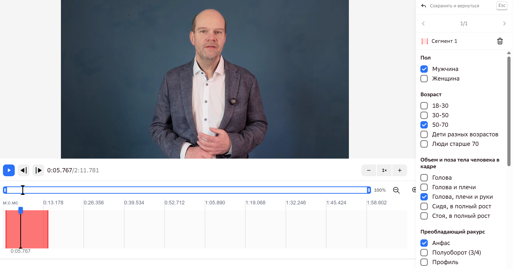
*Пример корректного заполнения: в каждой группе отмечено ровно одно значение
(«Мужчина», «50-70», «Голова, плечи и руки», «Анфас»).*

✅ **Множественный выбор** в некоторых вопросах возможен **только** если в кадре 2 и более
**говорящих/поющих** человека — тогда в некоторых полях можно отметить несколько значений.
Если в кадре двое, а говорит только один, это монолог: **все метки (пол, возраст, эмоции и
т.д.) ставим только по говорящему**. Второго человека учитываем только в поле
[«Количество людей, одновременно находящихся в кадре»](#12-количество-людей-одновременно-находящихся-в-кадре)
(значение «Два и более человека в кадре»).

**Пример:**

- [в сегменте 13:20–13:40 говорит только женщина, мужчина рядом смеётся — пол и остальные поля ставим только по женщине, в поле «Количество людей» — «Два и более человека в кадре»](https://gigaeye-kandinsky-spark.obs.ru-moscow-1.hc.sbercloud.ru/kandi_de_team/post_train/pre_stage/video/avatars/b6d1b78f-4b05-4c96-88f7-dc13e8e8273b/downloaded_raw/oa-MK6l_hgE.mp4)

`[Инструкция заказчика, 12.10.2026; Ответ заказчика по запросу от 14.10.2026; Разъяснения по
вопросам. Аватар 2 этап, 15.10.2026]`

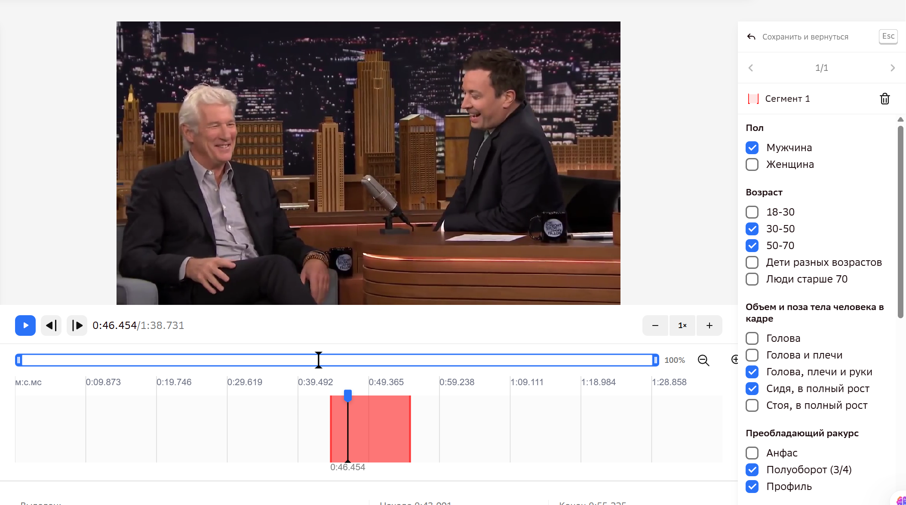

✅ **Люди на заднем плане не учитываются** в полях, касающихся информации о человеке (пол,
возраст, эмоции и др.) — заполняем их **только по центральному/главному человеку в кадре**,
даже если на фоне видны другие люди. `[Разметка ВК видео — ОС 25.05 СТ2]`

⚠️ Если в кадре **два (и более) центральных человека одновременно отвечают/говорят** (например,
интервью с двумя гостями, или говорят между собой по очереди), это диалог: нужно отмечать
характеристики обоих, а не выбирать одного «главного».
`[Разметка ВК видео — ОС по Заявкам 26-28, 05.08.2026; Инструкция заказчика, 12.10.2026]`

⚠️ **Молчащий, но хорошо видимый (не фоновый) человек в кадре тоже не учитывается** в полях
о человеке (пол, возраст, эмоции и т.п.). Критерий — не позиция в кадре, а то, **говорит/поёт
ли человек именно в этом сегменте**: если из двух людей на переднем плане в сегменте звучит
только один (второй присутствует молча, например ещё не вступил в песне) — поля заполняются
**только по звучащему**. Если сегмент захватывает момент, когда оба поют/говорят вместе —
заполняем поля по обоим, как в правиле выше про двух и более говорящих.

⚠️ Многие категории классификатора (освещение, фон, темп речи и др.) несут **оценочный
характер** — где-то нельзя точно сказать, какой там верный ответ; это используется для
балансировки датасета, а не как жёсткий тест на правильность.
`[Переписка в Telegram с заказчиком, 04.02.2026]`

`[Инстр. Kandinsky-Аватар, стр.5]`

`[Памятка «Аватар 2 этап», стр.2-3]`

## Поля классификатора

Классификатор в интерфейсе разметки состоит из **13 полей**. Ниже — каждое поле по порядку.

### 1. Пол

<ul class="value-checklist">
<li>Мужчина</li>
<li>Женщина</li>
</ul>

Если в кадре одновременно и мужчина, и женщина — отмечаем оба варианта.

⚠️ Пол и язык (см. также [«Язык и акценты»](#10-язык-и-акценты) ниже) — поля с объективно
проверяемым ответом, а не оценочные (в отличие, например, от освещения): заказчик проверяет их
так же строго, как границы сегмента.
`[Уточнение пользователя, 18.08.2026; ОС 28.07.2026]`

### 2. Возраст

<ul class="value-checklist">
<li>18-30</li>
<li>30-50</li>
<li>50-70</li>
<li>Дети разных возрастов</li>
<li>Люди старше 70</li>
</ul>

Если в кадре люди разных возрастных групп — отмечаем несколько вариантов.

### 3. Объём и поза тела человека в кадре

<ul class="value-checklist">
<li>Голова</li>
<li>Голова и плечи</li>
<li>Голова, плечи и руки</li>
<li>Сидя в полный рост</li>
<li>Стоя в полный рост</li>
</ul>

- **Голова** — в кадре видна только голова человека (с шеей или без неё); плечи не видны.
- **Голова и плечи** — видны голова и плечи (достаточно хотя бы одного плеча), человека видно
  по грудь/пояс; руки/кисти рук в кадре не видны — это касается и случая, когда в кадр попадают только кончики пальцев
  (а не вся кисть руки). `[Разметка ВК видео — ОС 22.05 СТ2]`
- **Голова, плечи и руки** — видны голова, плечи и руки (даже ненадолго), например человек
  сидит за столом; сюда же относится кадр, обрезанный прямо по линии колен без запаса выше,
  и случай, когда видны только колени (часть колена), а бёдра не видны — например, человек
  сидит поджав колени к груди. `[FAQ «Примеры», дополнено 13.03; Встреча с новичками по 2
  этапу, 29.07.2026; Комментарий валидатора по заданию, 18.08.2026]`
- **Сидя в полный рост** — человек сидит, обязательно видны бёдра вместе с коленями.
  Голеностоп видеть не обязательно.
- **Стоя в полный рост** — человек стоит, обязательно видны бёдра вместе с коленями.
  Голеностоп видеть не обязательно.

`[Памятка «Аватар 2 этап», стр.5]`

⚠️ **Логика правила — объём тела, а не количество коленей в кадре.** Дело не в том, видно ли
одно колено или оба, а в том, видна ли **бедренная часть ноги**. Та же логика — что для стоящего,
что для сидящего человека: если бёдра не видны, а видна только коленка (или даже обе) — это
по-прежнему «Голова, плечи и руки» (человек виден по грудь), а не «полный рост».
`[Разметка ВК видео — ОС 2 этап, 03.09.2026]`

⚠️ Если **пальцы человека попали в кадр буквально на долю секунды** (кисти рук при этом
полностью не видны) — ставьте «Голова и плечи».
`[Комментарии для мануала ко 2 этапу Аватара, 04.09.2026]`

⚠️ **Граница между «Голова» и «Голова и плечи».** «Голова» ставится, только когда видна одна
голова и шея (или голова без шеи). Если в кадре видно **хотя бы одно плечо** — пусть оно
обрезано краем кадра и видно не до локтевого сустава — ставьте уже «Голова и плечи». На практике значение «Голова» встречается **очень редко**.
`[Разметка ВК видео — ОС 2 этап, вердикт заказчика, 21.09.2026; Ответы на вопросы 2 этап,
21.09.2026]`

⚠️ Это правило (в первую очередь про руки/кисти) активно проверяется на практике — «не
отмечены руки, хотя они видны в кадре» стала одной из самых частых ошибок. `[Инстр.
Kandinsky-Аватар, стр.5, Upd 21.05]`

**Примеры:**

- [**Голова и плечи** — кисти рук не видны (78.4–95.9)](https://gigaeye-kandinsky-spark.obs.ru-moscow-1.hc.sbercloud.ru/ak/youtube/avatar/15_05_2026/eaccT4AP480/eaccT4AP480.mp4)
- [**Голова и плечи** — кисти рук не видны (0:01.03–0:31.01)](https://gigaeye-kandinsky-spark.obs.ru-moscow-1.hc.sbercloud.ru/ak/youtube/avatar/09_06_2026/KTSC0ERroEY/KTSC0ERroEY.mp4)
- [**Голова и плечи**, а не «Голова» — в кадре видно одно плечо (12.9–30.0)](https://gigaeye-kandinsky-spark.obs.ru-moscow-1.hc.sbercloud.ru/kandi_de_team/post_train/pre_stage/video/avatars/2e27a696-5f02-4d90-9db5-893ba5a32136/downloaded_raw/kicq8xb_Uq8.mp4)
- [**Голова и плечи** — пальцы мелькнули на долю секунды, кисти не видны (2.05–36.2)](https://gigaeye-kandinsky-spark.obs.ru-moscow-1.hc.sbercloud.ru/kandi_de_team/post_train/pre_stage/video/avatars/2e27a696-5f02-4d90-9db5-893ba5a32136/downloaded_raw/ugOTJA0NGAQ.mp4)
- [**Голова и плечи** — руки в кадре ни разу не появились (0.6–15.1)](https://gigaeye-kandinsky-spark.obs.ru-moscow-1.hc.sbercloud.ru/kandi_de_team/post_train/pre_stage/video/avatars/aad81115-c102-4001-8e6a-67207c05ec73/downloaded_raw/RkGxPqM_JOE.mp4)
- [**Голова и плечи** — руки не видны (63.5–78.3)](https://gigaeye-kandinsky-spark.obs.ru-moscow-1.hc.sbercloud.ru/kandi_de_team/post_train/pre_stage/video/avatars/2e27a696-5f02-4d90-9db5-893ba5a32136/downloaded_raw/v-I9QfdvGvA.mp4)
- [**Голова, плечи и руки** — (53.9–64.0)](https://gigaeye-kandinsky-spark.obs.ru-moscow-1.hc.sbercloud.ru/ak/youtube/avatar/15_05_2026/OoieiT1G5DY/OoieiT1G5DY.mp4)
- [**Голова, плечи и руки** — (18.9–29.3)](https://gigaeye-kandinsky-spark.obs.ru-moscow-1.hc.sbercloud.ru/ak/youtube/avatar/18_05_2026/OlfLhQb4av8/OlfLhQb4av8.mp4)
- [**Сидя в полный рост** — колени уже видны (до 0:53)](https://gigaeye-kandinsky-spark.obs.ru-moscow-1.hc.sbercloud.ru/ak/youtube/avatar/15_05_2026/alDyTf-EX1Y/alDyTf-EX1Y.mp4)
- [**Стоя в полный рост** — колени уже видны](https://gigaeye-kandinsky-spark.obs.ru-moscow-1.hc.sbercloud.ru/ak/youtube/avatar/15_05_2026/3fhv7tzaLHw/3fhv7tzaLHw.mp4)

`[Журнал проверок ОС; Разметка ВК видео — ОС 2 этап, 21.09.2026]`

**Скриншоты для наглядности:**

<!-- video-eyebrow: 3. Объём и поза тела — скриншоты -->

- 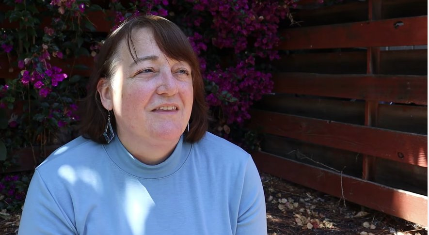
- 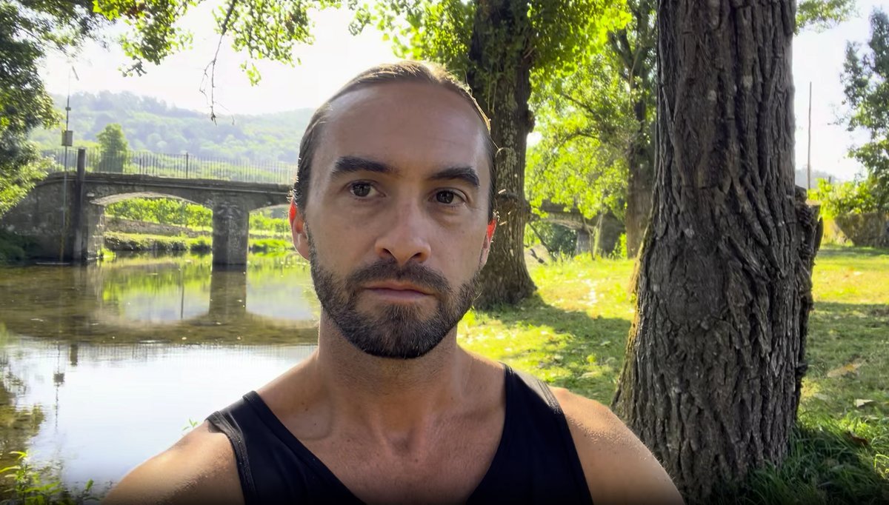
- 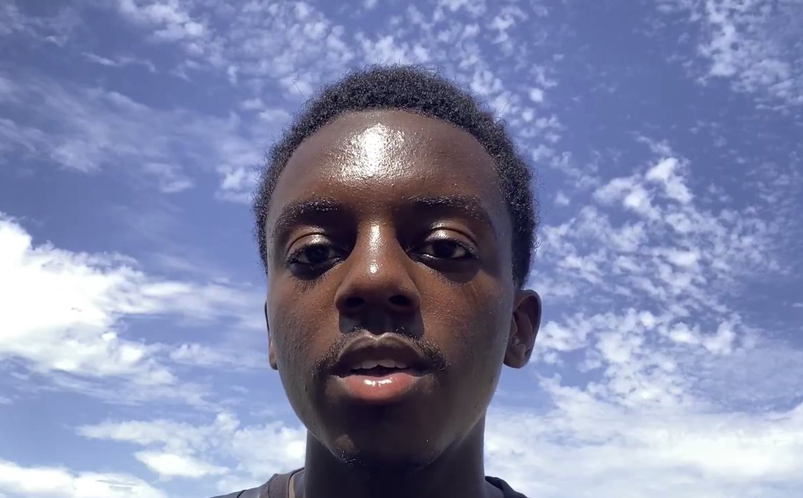
- 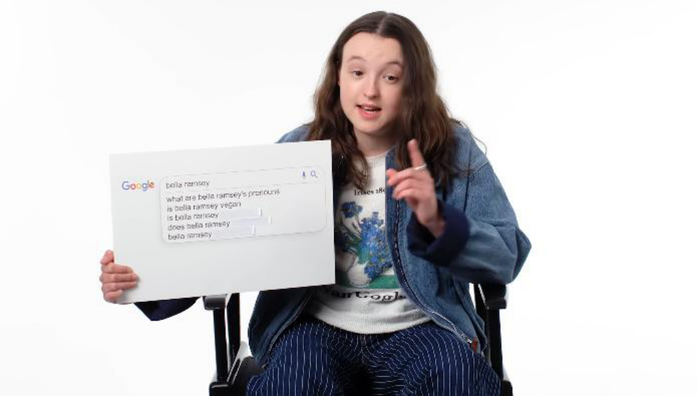
- 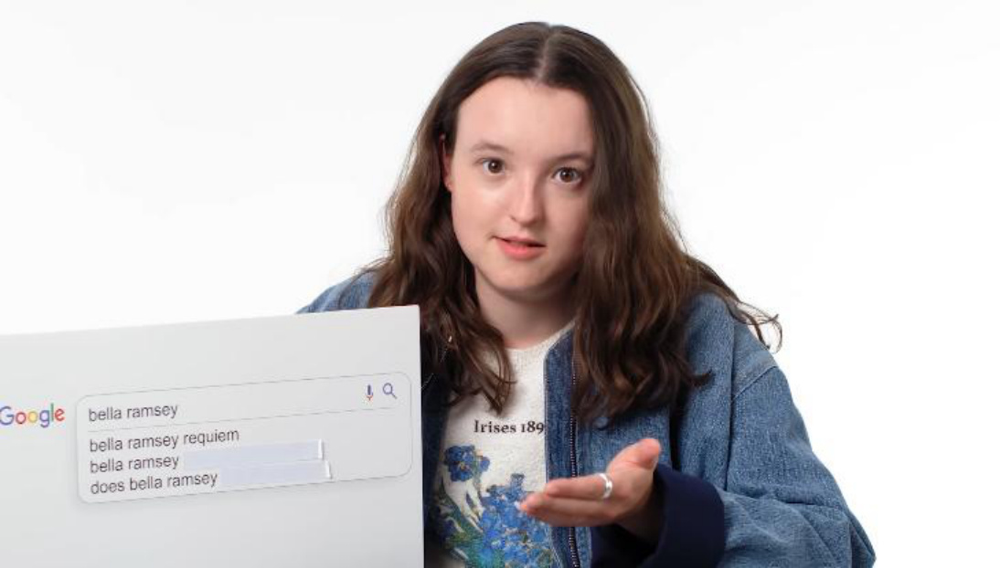
- 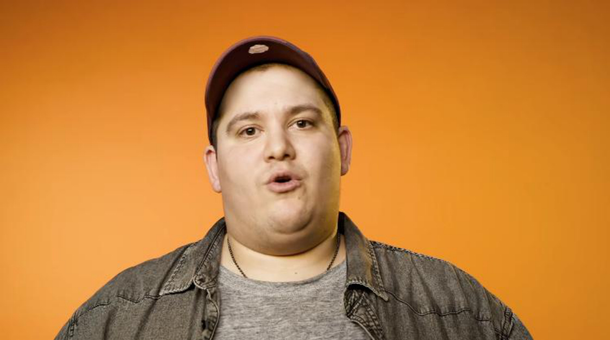
- 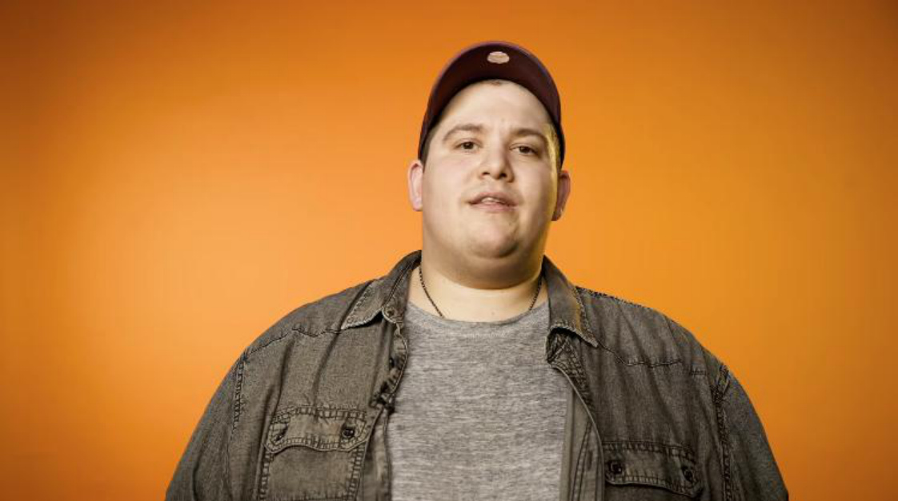
- 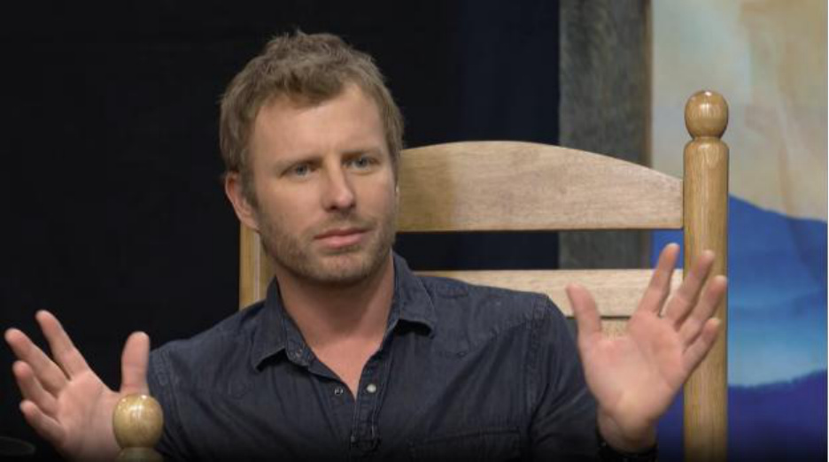
- 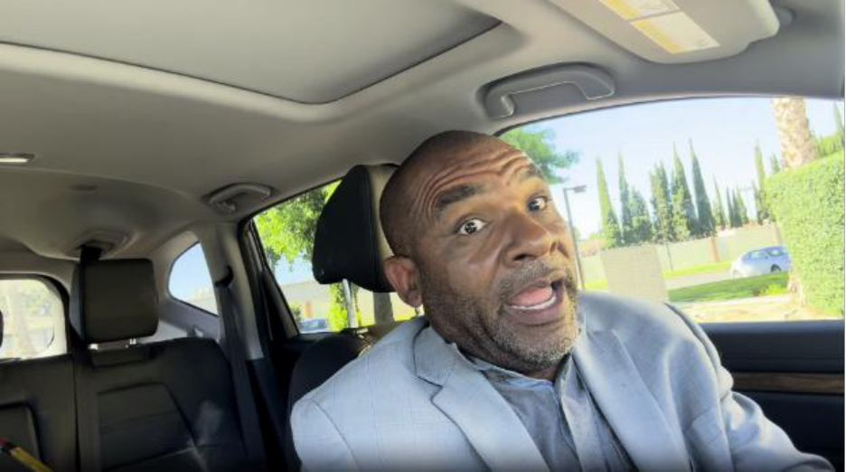
- 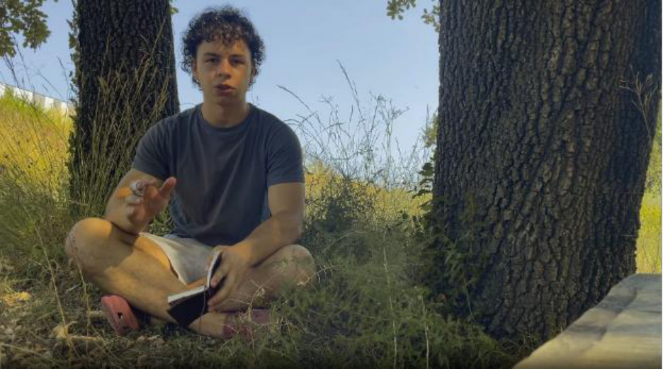

Две пары «дальность плана» — пример и антипример из инструкции заказчика к правилу деления
сегмента (когда меняется поза — значение поля меняется, это два сегмента; когда меняется только
дальность плана — значение то же, сегмент один), см.
[«Однотипные и разные фрагменты»](02-segments.md#однотипные-и-разные-фрагменты).
`[Ответы на вопросы 2 этап, 21.09.2026; Инструкция заказчика, 12.10.2026]`

### 4. Преобладающий ракурс

<ul class="value-checklist">
<li>Анфас</li>
<li>Полуоборот (3/4)</li>
<li>Профиль</li>
</ul>

- **Анфас** — человек смотрит прямо в камеру, лицо видно фронтально.
- **Полуоборот (3/4)** — лицо видно, но человек повёрнут к камере одним боком.
- **Профиль** — человек развёрнут боком, видна только одна сторона лица (левая или
  правая).

`[Памятка «Аватар 2 этап», стр.5]`

⚠️ **Анфас — это когда видны оба глаза и оба уха** (если на человеке шапка, мысленно её
снимаем). Если голова почти всё время повёрнута то в одну, то в другую сторону, а прямо к камере
лицо поворачивается лишь на 2–3 секунды из всего сегмента — это не анфас.
`[Разъяснения по вопросам. Аватар 2 этап, 15.10.2026]`

⚠️ Если человек постоянно **поворачивает голову (то анфас, то профиль, то полуоборот)** и
«поймать» устойчивые 10 секунд в одном положении невозможно — ставим тот ракурс, который
**преобладает** по факту в выбранном сегменте. Само по себе такое поведение — не повод отправлять видео в «Битое»: сегмент
всё равно выделяем, просто по преобладающему ракурсу. `[Видео с разбором ошибок — Аватар 2
этап]`

⚠️ **Практический критерий «профиль vs потеря лица»:**

— **профиль** — это когда человек повернут боком, но нос всё ещё виден сбоку от лица
(виден его силуэт).

— **потеря лица** — это когда человек повернул голову ещё дальше, так что нос «уходит за
угол» и перестаёт быть виден; такой момент не должен попадать в сегмент, нужно искать
более подходящий по времени участок.
`[Встреча с новичками по 2 этапу, 29.07.2026]`

💬 Отдельный нюанс (не прописан в ТЗ/ОС явно, но подтверждён практикой) — где граница между
**полуоборотом и профилем**: пока со стороны камеры виден **второй (дальний) глаз** —
это ещё полуоборот, даже если голова повёрнута почти до профиля. Как только второй глаз
перестаёт быть виден — это уже профиль. `[Практика исполнителей]`

⚠️ Если по всему сегменту ракурс делится примерно **50/50 между двумя значениями и явно
преобладающего нет** — по возможности лучше подобрать более однородный участок; если такого
участка на видео действительно нет, решение «по наитию» допустимо, но это редкий,
нежелательный случай, а не рабочая практика по умолчанию.
`[Встреча с новичками по 2 этапу, 29.07.2026]`

⚠️ Если человек постоянно крутит головой или ракурс делится 50/50 — можно отметить **любой,
но только один** ракурс, ошибку за такой выбор не ставят. `[Ответы на вопросы по Аватару,
02.09.2026]`

**Примеры:**

- [**Анфас** (0:06.48–0:18.06)](https://gigaeye-kandinsky-spark.obs.ru-moscow-1.hc.sbercloud.ru/ak/youtube/avatar/09_06_2026/5RoBwOlETRk/5RoBwOlETRk.mp4)
- [**Полуоборот (3/4)** (4.1–44.1)](https://gigaeye-kandinsky-spark.obs.ru-moscow-1.hc.sbercloud.ru/ak/youtube/avatar/22_05_2026/r0_VQdrJsSM/r0_VQdrJsSM.mp4)
- [**Профиль** (64.3–80.6)](https://gigaeye-kandinsky-spark.obs.ru-moscow-1.hc.sbercloud.ru/ak/youtube/avatar/15_05_2026/z_9xxDP2ISM/z_9xxDP2ISM.mp4)
- [**Полуоборот (3/4)**](https://gigaeye-kandinsky-spark.obs.ru-moscow-1.hc.sbercloud.ru/ak/avatar/3ac0d9c6-6b88-4a08-92bc-9be5e9cd1879/trimmed/-177876997_456239025__segment_1_25_47__seg1.mp4)
- [**Ракурс меняется в пределах ролика** — берём преобладающее значение, это не «Битое»](https://gigaeye-kandinsky-spark.obs.ru-moscow-1.hc.sbercloud.ru/ak/avatar/34369717-c2c7-4230-a8e7-c3a679803c7d/trimmed/-201254813_456239373__segment_1_2_45.mp4)
- [**Ракурс меняется в пределах ролика** — берём преобладающее значение, это не «Битое»](https://gigaeye-kandinsky-spark.obs.ru-moscow-1.hc.sbercloud.ru/ak/avatar/34369717-c2c7-4230-a8e7-c3a679803c7d/trimmed/-186339672_456239137__segment_2_175_191__seg2.mp4)
- [Человек постоянно крутит головой (с 8 сек — два основных ракурса, полуоборот и профиль) — выбираем только один](assets/o0g3jYZ_ORM.mp4)
- [**Не анфас** (00:39–00:56) — голова почти всё время повёрнута то в одну, то в другую сторону, прямо в камеру лицо смотрит 2–3 секунды из 17](https://gigaeye-kandinsky-spark.obs.ru-moscow-1.hc.sbercloud.ru/kandi_de_team/post_train/pre_stage/video/avatars/51f72751-186f-403e-b186-3394ba9a1e29/downloaded_raw/nj5dqPTlenU.mp4)

`[Журнал проверок ОС; Инструкция заказчика, 25.09.2026; Разъяснения по вопросам. Аватар 2
этап, 15.10.2026]`

### 5. Освещение

<ul class="value-checklist">
<li>Мягкое студийное</li>
<li>Естественное</li>
<li>Сложное</li>
</ul>

- **Мягкое студийное** — искусственный свет (лампы, студия, комната), который **мягко и
  равномерно** освещает лицо говорящего. Если источник
  света в кадре не виден, но заметно **отражение кольцевой лампы в глазах** (характерный
  блик-кольцо) — тоже ставим это значение.
- **Естественное** — виден источник света в виде окна, либо человек снят на улице. Окно не
  обязательно должно быть видно в кадре напрямую — достаточно косвенных признаков (например,
  видно отражение дневного/закатного света в комнате).
- **Сложное** — источник света сзади (контровой) или другая явно сложная световая схема.
  Несколько **разных** источников света одновременно, с разных сторон (например, с одной
  стороны лампа, с другой — солнце из окна), либо разноцветный свет.

⚠️ На практике «Сложное» освещение встречается крайне редко — в подавляющем большинстве
случаев подходит «Мягкое студийное» или «Естественное». `[Встреча с новичками по 2 этапу,
29.07.2026]`

💡 **Освещение должно соответствовать окружающей обстановке:** улица — «Естественное», студия —
«Мягкое студийное». Если человек сидит в парке, а в классификаторе отмечено «Мягкое
студийное» — это ошибка. `[Ответы на вопросы по Аватару, 02.09.2026; Инструкция заказчика,
12.10.2026]`

⚠️ **Помещение — ещё не «Мягкое студийное».** Не ориентируйтесь механически на «улица =
естественное, помещение = студийное», смотрите, как свет ложится на лицо. Если свет падает
неравномерно (например, освещены лоб и шея, а половина лица в тени) и он явно смешанный — это
«Сложное». `[Разъяснения по вопросам. Аватар 2 этап, 15.10.2026]`

**Примеры:**

- [**Естественное** — легко ошибочно принять за «студийное»](https://gigaeye-kandinsky-spark.obs.ru-moscow-1.hc.sbercloud.ru/ak/youtube/avatar/27_05_2026/9k4hkY8Cy5E/9k4hkY8Cy5E.mp4)
- [**Естественное** (0–86.3) — а не «мягкое студийное»](https://gigaeye-kandinsky-spark.obs.ru-moscow-1.hc.sbercloud.ru/ak/youtube/avatar/22_05_2026/0AiCXmNJGvk/0AiCXmNJGvk.mp4)
- 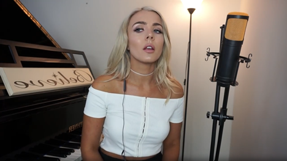
- 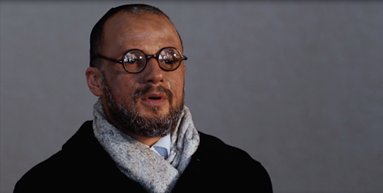
- 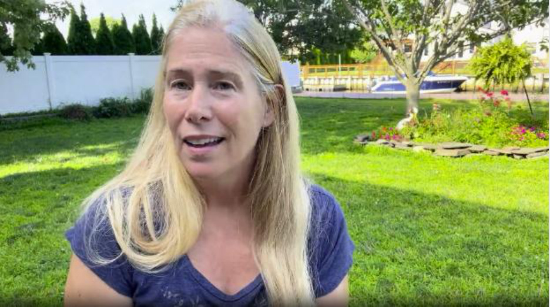
- [**Сложное** (00:00–00:15) — спортзал: светильники на потолке, свет ложится на лоб и шею, половина лица в тени, освещение смешанное. Не «Мягкое студийное»](https://gigaeye-kandinsky-spark.obs.ru-moscow-1.hc.sbercloud.ru/kandi_de_team/post_train/pre_stage/video/avatars/a5e9b0fb-37fa-4762-9946-ed20ef96e664/downloaded_raw/GjmCAd_Oq58.mp4)

`[Ответы на вопросы по Аватару, 02.09.2026; Инструкция заказчика, 12.10.2026; Разъяснения по
вопросам. Аватар 2 этап, 15.10.2026]`

### 6. Фон

<ul class="value-checklist">
<li>Нейтральный/размытый</li>
<li>Естественный, но статичный</li>
<li>Динамичный/уличный</li>
</ul>

- **Нейтральный/размытый** — однотонный, замыленный фон.
- **Естественный, но статичный** — обычная бытовая обстановка (комната, студия
  телепрограммы, школа и т.п.), в которой **за спиной ничего не движется**; неподвижная тень.
- **Динамичный/уличный** — за спиной говорящего есть **явное, активное движение** (оно не должно
  отвлекать от лица), в отражении (зеркало, стекло) присутствует движение, движущаяся/мерцающая
  тень.

⚠️ **Лёгкая, но заметная тень самого говорящего на фоне** (которая просто двигается вместе с
ним) — это не повод ставить «Динамичный/уличный». Речь выше о тени от стороннего источника
движения (чужая тень, мерцание), а не о собственной тени человека.
`[Инструкция заказчика, 12.10.2026]`

⚠️ Если на видео видны признаки того, что съёмка происходит на улице (деревья, земля,
экстерьер), нужно ставить **«Динамичный/уличный»**, даже если сам фон статичен и нет никакого
движения (дуновения ветра и т.п.) — критерий «на улице» срабатывает сам по себе, независимо от
динамики. `[Разметка ВК видео — ОС 20.05 СТ2]`

⚠️ **Одна лишь стена — ещё не улица.** Такая стена может быть и в помещении, поэтому по ней
одной «Динамичный/уличный» не ставим. Признаки улицы и динамики — деревья, проезжающий
транспорт, пролетающие птицы и т.п. **Ориентируйтесь только на границы выделяемого
сегмента:** если внутри выбранных границ нет ничего, что указывало бы на улицу или движение,
ставьте «Естественный, но статичный».
`[Разметка ВК видео — ОС 2 этап, вердикт заказчика, 21.09.2026]`

⚠️ **Явное, активное движение за спиной говорящего — это динамика**, как и съёмка на улице.
Если на фоне есть **незначительное, едва заметное движение** (чаще всего это какой-то мелкий
объект или что-то очень далёкое / в сильном расфокусе) — ставим «Естественный, но статичный».
При валидации очевидное действие на фоне, отмеченное статикой, считается ошибкой; динамику,
поставленную на незначительное едва заметное движение, обычно пропускают. На 3 этапе критерии
немного другие, см.
[мануал 3 этапа](../manual-3-etap/01-classifier.md#11-характеристика-фона-за-спиной-говорящего).
`[Ответ заказчика по запросу от 14.10.2026; Разъяснения по вопросам. Аватар 2 этап, 15.10.2026]`

⚠️ Категория **«Динамичный/уличный» — особенность именно 2 этапа**: сам факт съёмки на
улице (см. правило выше) переводит фон в «Динамичный/уличный» даже без движения. На 3 этапе
аналога этой связки нет — там «на улице, но без движения» классифицируется как
`natural_static`, а не `natural_dynamic`, см.
[мануал 3 этапа](../manual-3-etap/01-classifier.md#11-характеристика-фона-за-спиной-говорящего).
`[Разметка ВК видео — ОС 20.05 СТ2]`

⚠️ Если фон размыт **до практически неразличимых пятен** — ставьте «Нейтральный/размытый». Если
фон в **расфокусе** (резкость наведена на лицо), но **обстановка всё равно узнаваема** —
классифицируйте по тому, что реально видно за спиной («Естественный, но статичный» или
«Динамичный/уличный», смотря по ситуации), а не как «Нейтральный/размытый» — эта категория
именно про однотонный/замыленный фон по своей природе, а не про любой случайный расфокус
камеры.
`[Комментарии для мануала ко 2 этапу Аватара, 04.09.2026]`

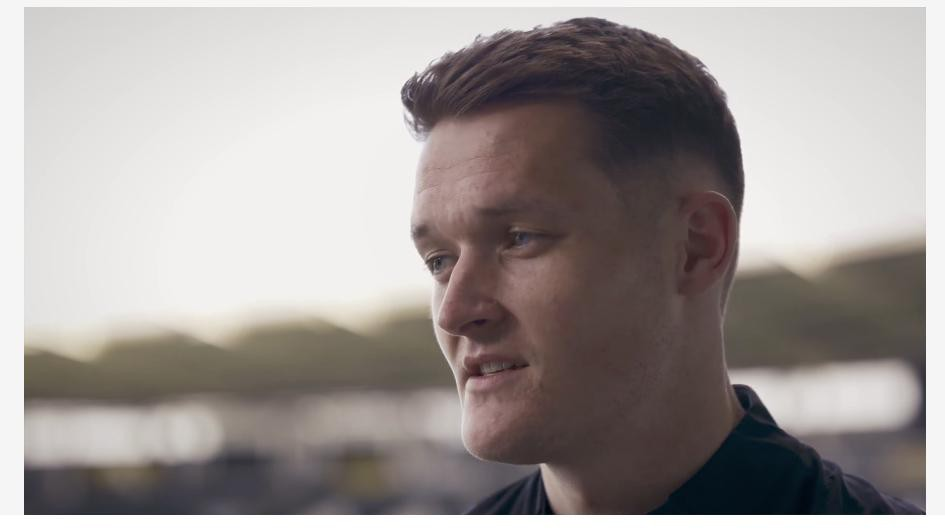

**Пример:** на этом кадре фон размыт до пятен — угадываются только силуэты холмов и построек на
заднем плане, похожие на улицу, но разглядеть их чётко нельзя. Несмотря на то что фон выглядит
«как будто улица», здесь нужно ставить **«Нейтральный/размытый»**, а не «Динамичный/уличный»: по
правилу выше решает степень размытия, а не то, что угадывается за ним.
`[ОС от заказчика, 21.10.2026]`

⚠️ Не путать со значением поля «Фон»: **виньетка (затемнение по краям кадра)** — это
наложенный эффект и признак брака, если во всём видео нет сегмента без неё; полная
формулировка правила —
[«Что не размечаем / Битое»](05b-what-not-to-label.md#-дефекты-которых-не-должно-быть-в-сегменте).

**Примеры:**

- [**Нейтральный/размытый** — однотонный тёмный фон](https://gigaeye-kandinsky-spark.obs.ru-moscow-1.hc.sbercloud.ru/ak/avatar/1f58db0b-da16-4b3c-80fe-1d647ee5c666/trimmed/-214391033_456239025__segment_1_0_92.mp4)
- [**Нейтральный/размытый** — однотонный тёмный фон](https://gigaeye-kandinsky-spark.obs.ru-moscow-1.hc.sbercloud.ru/ak/avatar/1f58db0b-da16-4b3c-80fe-1d647ee5c666/trimmed/-215695205_456239021__segment_1_17_37.mp4)
- [**Естественный, но статичный**](https://gigaeye-kandinsky-spark.obs.ru-moscow-1.hc.sbercloud.ru/ak/avatar/2d96202b-2347-4e9a-813c-d7ce2e6ccd70/trimmed/-59531176_456240190__segment_1_10_210.mp4)
- [**Естественный, но статичный**](https://gigaeye-kandinsky-spark.obs.ru-moscow-1.hc.sbercloud.ru/ak/avatar/2d96202b-2347-4e9a-813c-d7ce2e6ccd70/trimmed/-45583559_456240264__segment_2_176_206__seg2.mp4)
- [**Динамичный/уличный** — деревья на фоне, земля](https://gigaeye-kandinsky-spark.obs.ru-moscow-1.hc.sbercloud.ru/ak/youtube/avatar/15_05_2026/Zgmlx08HIR4/Zgmlx08HIR4.mp4)
- [**Динамичный/уличный** — люди позади двигаются](https://gigaeye-kandinsky-spark.obs.ru-moscow-1.hc.sbercloud.ru/ak/youtube/avatar/22_05_2026/sCkhgfDQUzI/sCkhgfDQUzI.mp4)
- [**Естественный, но статичный** — лёгкая тень говорящего на фоне не делает фон «динамичным»](assets/ouE8iUoB-f8.mp4)
- [**Динамичный/уличный** — крупный цветок на фоне долго дёргается (сегменты 00:00–00:21, 00:31–02:09, 04:09–04:48, 07:07–07:27)](https://gigaeye-kandinsky-spark.obs.ru-moscow-1.hc.sbercloud.ru/kandi_de_team/post_train/pre_stage/video/avatars/a20120cf-3450-4d78-8d8e-053fc5612dbd/downloaded_raw/lIKN_42aVPg.mp4)
- [**Динамичный/уличный** (00:52–01:32) — справа активно двигается человек](https://gigaeye-kandinsky-spark.obs.ru-moscow-1.hc.sbercloud.ru/kandi_de_team/post_train/pre_stage/video/avatars/7162ceab-d65a-4b05-b5fa-d218981cc76e/downloaded_raw/Yr3iraZ9k_8.mp4)

`[Разъяснения по вопросам. Аватар 2 этап, 15.10.2026]`

### 7. Эмоции и выражение лица

<ul class="value-checklist">
<li>Нейтральные/спокойные</li>
<li>Положительные</li>
<li>Серьёзные/сосредоточенные/негативные</li>
</ul>

- **Нейтральные/спокойные** — ровный тон голоса и выражение лица без выраженной
  эмоциональной окраски; самое частое значение поля (когда нет явных признаков
  положительной или серьёзной/негативной эмоции). Ставим, только если эмоции
  **практически отсутствуют**.
- **Положительные** — радость, улыбка, интерес.
- **Серьёзные/сосредоточенные/негативные** — удивление, сомнение, грусть; сюда же относятся
  **злость и явная напряжённость**, когда по человеку видно, что тема его беспокоит, «трогает
  за живое», раздражает или злит.

`[Инстр. Kandinsky-Аватар, стр.4; Памятка «Аватар 2 этап», стр.5; Ответы на вопросы 2 этап,
21.09.2026]`

⚠️ При определении эмоции ориентироваться стоит в первую очередь на **интонацию и тон
голоса, а не на мимику/выражение лица саму по себе**. Улыбка на лице сама по себе не
считается положительной эмоцией, если тон голоса ей не соответствует. Показательный
пример — актёрские видеовизитки: человек может улыбаться, отыгрывая роль, но при этом
говорить грустным/подавленным тоном — в таком случае эмоция ставится по голосу
(грустная/серьёзная), а не «положительная» по лицу.
`[Встреча с новичками по 2 этапу, 29.07.2026; Ответы на вопросы по Аватару, 02.09.2026]`

⚠️ **Экспрессивные, театральные эмоции** (наигранная подача, утрированная мимика и интонация)
отмечаем как **«Серьёзные/сосредоточенные/негативные»**, а не «Нейтральные/спокойные».
`[Ответ заказчика по запросу от 14.10.2026]`

⚠️ **Смена эмоций внутри одного ролика** влияет на то, сколько сегментов выделять, см. правило
и источники в [02-segments.md](02-segments.md#когда-объединятьделить-сегмент).

**Примеры:**

- [Человек улыбается/смеётся — эмоция положительная](assets/hYRf9bHd7Ic__segment_0479338_4206752.mp4)
- [Человек улыбается, но интонация не положительная — эмоция ставится по голосу, а не по улыбке](assets/BUQLVpsqn88.mp4)

`[Инструкция заказчика, 25.09.2026]`

- [**Положительные** (01:17–01:28)](https://gigaeye-kandinsky-spark.obs.ru-moscow-1.hc.sbercloud.ru/kandi_de_team/post_train/pre_stage/video/avatars/6b0f8d27-9fb9-42d0-bbb4-9225848f802b/downloaded_raw/-lEZuLLtX6M.mp4)

`[Разъяснения по вопросам. Аватар 2 этап, 15.10.2026]`

### 8. Тип речи

<ul class="value-checklist">
<li>Монолог (подготовленный)</li>
<li>Монолог (спонтанный)</li>
<li>Диалог (ответы на вопросы)</li>
</ul>

- **Монолог (подготовленный)** — заученная или срежиссированная речь (лекции, презентации,
  новости, актёрские видеовизитки; чёткая дикция, минимум пауз и оговорок).

⚠️ Признак **«монолог подготовленный» на актёрских видеовизитках** — не столько язык или
темп речи, сколько структура ролика: спокойное самопредставление (часто с поворотами,
демонстрацией рук) → резкая смена характера/настроения → драматический фрагмент. Если видно
такую структуру — это подготовленный монолог, даже если язык неизвестен.
`[ОС заказчика, 23.07.2026]`

⚠️ **Монолог vs закадровый голос:** если на видео есть второй, закадровый голос (например,
интервьюер за кадром), а в сегмент мы его не включаем (см.
[01-general-requirements.md](01-general-requirements.md)), то оставшийся говорящий в кадре
человек — это **монолог**, а не диалог: закадровый голос не считается вторым участником для
целей этого поля. `[ОС заказчика, 17.07.2026]`

⚠️ Сам факт, что **реплики срежиссированы для видеовизитки** (даже в формате «вопрос-ответ»),
делает тип речи **подготовленным целиком**, независимо от того, включён ли закадровый вопрос в
сегмент. Даже если убрать закадровый голос из сегмента и считать, что нет формального ответа
«здесь и сейчас» на конкретный вопрос — это не «спонтанный монолог», а всё равно
«подготовленный» на всех сегментах этого ролика без исключения.
`[Разметка ВК видео — ОС 27.05 СТ2]`

- **Монолог (спонтанный)** — неподготовленная речь (влоги, рассказы, размышления вслух, а
  также ответы на вопросы интервьюера за кадром — после того как сам закадровый вопрос убран
  из сегмента, см. ниже; естественные паузы, междометия).
- **Диалог (ответы на вопросы)** — разговор двух и более людей в кадре, отвечающих друг другу
  (интервью, подкасты; эмоциональная окраска, живая реакция на собеседника).

`[Инстр. Kandinsky-Аватар, стр.3]`

⚠️ Если в кадре 2 и более человек, это не автоматически диалог. **Диалог** ставится, только
когда они говорят между собой. Если говорит фактически один из них (второй просто
присутствует в кадре) — это **монолог** (второй человек при этом всё равно учитывается в
отдельном поле «количество людей в кадре», просто без меток по типу речи/эмоциям/etc.).
`[Ответы на вопросы по Аватару, 02.09.2026]`

⚠️ **Уточнение: «поддакивание» второго человека — это уже диалог, а не монолог.** Если один
человек говорит почти всё время, а второй издаёт короткие реплики-реакции («ага», кивки со
звуком и т.п. — «поддакивает»), это тоже считается диалогом: разница именно в том, произносит
ли второй человек что-то вслух, а не в том, кто говорит дольше.
`[Ответы на вопросы по Аватару, 02.09.2026]`

⚠️ **То же самое — для пения.** Тип речи считается по количеству людей, от которых реально
исходит звук (поют/говорят), а не по тому, отвечают ли они друг другу репликами — у пения,
в отличие от разговора, обычно и не бывает вопросов-ответов. **Поёт один человек** — это
**монолог** (даже если рядом молча присутствует ещё кто-то), а **поют двое и более** (дуэтом,
хором, по очереди) — уже **диалог**, даже если они не «переговариваются» между собой в
привычном смысле, а просто поют вместе. `[Уточнение пользователя, 16.09.2026]`

⚠️ **Если в кадре два человека ведут активный диалог, и выделить 10+ секунд с тем, кто виден
лучше, без участия второго не получается** — размечаем фрагмент целиком как диалог с двумя
людьми в кадре. **Если же можно набрать 10+ секунд, где говорит только один из них (без
второго в кадре в этот момент)** — такой фрагмент выделяем отдельно, как один человек,
«монолог спонтанный».
`[Видео с разбором ошибок — Аватар 2 этап]`

⚠️ **Диалог и отдельные говорящие.** На видео, где **один и тот же ведущий и много
опрашиваемых**, не нужно делить ролик на огромное количество сегментов, выделяя диалог, потом
монолог внутри диалога и т.д. — здесь важнее выделить **разных говорящих людей**. Если же на
протяжении всего видео в кадре **только два одних и тех же человека**, можно выделить сегмент с
диалогом, а также сегмент, в котором говорит только один из них, — но критичного характера это
не несёт.
`[Ответ заказчика по запросу от 14.10.2026; Разъяснения по вопросам. Аватар 2 этап, 15.10.2026]`

**Примеры:**

- [Говорит на камеру один человек — монолог](assets/Ob8ICsKhsTc__segment_38758126_78550061.mp4)
- [Один говорит, второй «поддакивает» — это уже диалог](assets/xee6f8dBB58__segment_0312614_74402193.mp4)
- [Поёт/говорит только один человек в кадре — монолог, не диалог](https://gigaeye-kandinsky-spark.obs.ru-moscow-1.hc.sbercloud.ru/ak/youtube/avatar/15_05_2026/IMAX12ePRaY/IMAX12ePRaY.mp4)

`[Инструкция заказчика, 25.09.2026; Топ-5 ошибок — Инструкция заказчика, 12.10.2026]`

### 9. Темп речи

<ul class="value-checklist">
<li>Медленный</li>
<li>Быстрый</li>
</ul>

⚠️ **Оценивайте темп речи на обычной скорости просмотра**, без ускорения/замедления. Это
довольно субъективный параметр, и валидаторы не проверяют его слишком строго — но если
очевидно, что человек говорит быстро (например, испанский/португальский язык), а стоит
«Медленный», это будет засчитано как ошибка.
`[Комментарии для мануала ко 2 этапу Аватара, 04.09.2026]`

### 10. Язык и акценты

<ul class="value-checklist">
<li>Русский</li>
<li>Английский</li>
<li>Другой</li>
</ul>

⚠️ Если в сегменте звучит преимущественно один язык, а другой — буквально одно слово/фраза,
**отмечаем только преобладающий язык** (например, человек говорит 95% по-английски — ставим
только английский). **Второй язык отмечаем дополнительно**, только если он тоже занимает
заметную, значимую долю сегмента, а не мимолётное вкрапление. `[Разметка ВК видео — ОС
экзамен 2 этап 05.08]` Если же в сегменте ровно **50/50** говорят на двух языках —
отмечаем **оба**. `[Ответы на вопросы по Аватару, 02.09.2026]`

⚠️ **Названия и имена собственные**, которые невозможно естественно произнести на
преобладающем языке (бренды, топонимы, имена людей и т.п.), **в долю «второго языка» не
засчитываются** — даже если таких слов в сегменте несколько, это не переключение языка, а
непереводимое слово/название.
`[Разметка ВК видео — ОС 2 этап, 03.09.2026]`

⚠️ Отдельно про **сильный акцент (без смешения языков)**: если акцент сильный, но речь всё
равно разборчива и понятно, что человек говорит по-русски — ставим «русский». Если же речь
настолько смешана с другим языком/акцентом, что разобрать её тяжело — ставим «другой язык».
`[Видео с разбором ошибок — Аватар 2 этап]`

**Примеры:**

- [Английский язык](assets/-94892022_171336072__segment_1_31_42__seg1.mp4)
- [Другой язык](assets/CZgTL3KqHtg__segment_23111611_34403896.mp4)
- [Русский язык](assets/dVqpQtlTh2M__segment_2_108_119__seg2.mp4)

`[Инструкция заказчика, 25.09.2026 и 12.10.2026]`

### 11. Группа данных

<ul class="value-checklist">
<li>Студия</li>
<li>Естественная среда</li>
</ul>

- **Студия** — искусственная среда (фотостудия, съёмка шоу), специально подготовленная для
  съёмки: корпоративные видео, интервью на нейтральном фоне, лекции и стримы с хорошим
  оборудованием (профессиональное освещение и звук, нейтральный статичный фон).
- **Естественная среда** — обычная бытовая обстановка (кабинеты, улица и т.д.): подкасты,
  видеоблоги, видеозвонки и интервью на улице (камера статична или движется плавно, свет и
  фон могут быть неидеальными, слышны лёгкие фоновые звуки). Обычная жилая квартира с
  нейтральной стеной — это всё ещё «Естественная среда», а не «Студия», если не выглядит
  специально подготовленной для съёмки.

`[Инстр. Kandinsky-Аватар, стр.2; Разметка ВК видео — ОС Экзамен 18.05 СТ2]`

⚠️ На практике значения «Студия» и фон «Нейтральный/размытый» чаще всего идут в паре, но это
разные поля классификатора — заполнять их нужно независимо друг от друга.
`[Встреча с новичками по 2 этапу, 29.07.2026]`

⚠️ Это поле — **одиночный выбор**: выбор сразу двух пунктов («Студия» + «Естественная среда»)
— реальная ошибка, которую отмечал заказчик. `[ОС заказчика, 17.06.2026]`

**Примеры:**

- 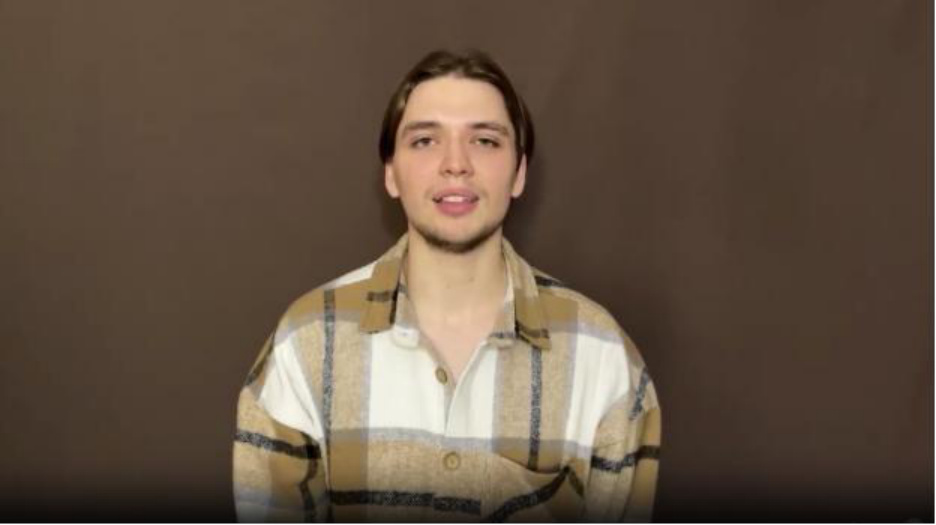
- 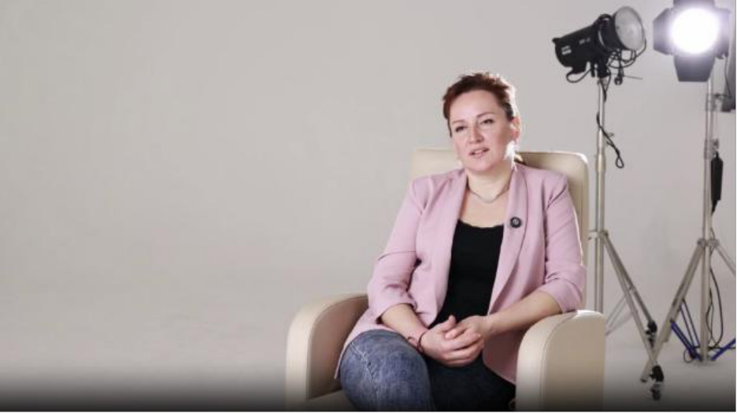
- 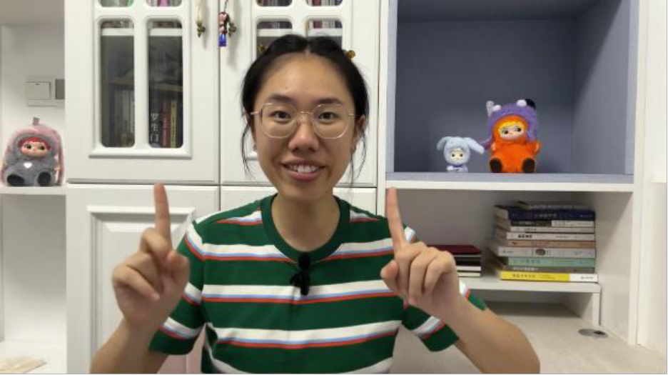
- 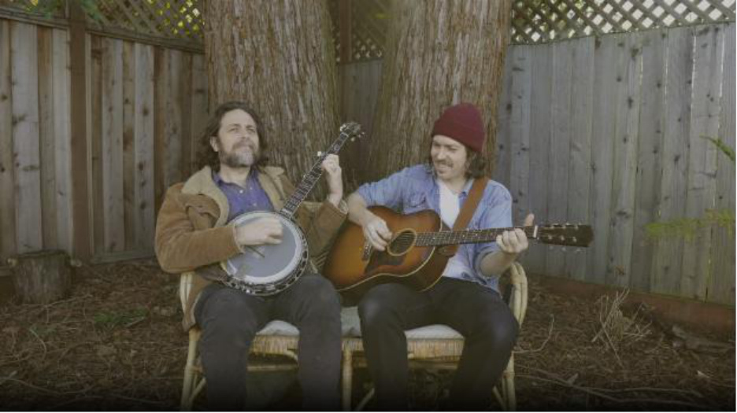

`[Инструкция заказчика, 12.10.2026]`

### 12. Количество людей, одновременно находящихся в кадре

<ul class="value-checklist">
<li>Один человек в кадре</li>
<li>Два и более человека в кадре</li>
</ul>

- **Один человек в кадре** — в выбранном сегменте виден один человек (независимо от того,
  говорит ли он). Люди на заднем плане (мимо проходящие, мелькнувшие вдали) не считаются.
- **Два и более человека в кадре** — в выбранном сегменте видно двух и более людей из тех, кого
  снимает камера: спикеров и тех, кто стоит рядом со спикером (в том числе молча).

`[Памятка «Аватар 2 этап», стр.6; Инструкция заказчика, 04.09.2026]`

⚠️ **Людей на фоне не отмечаем.** Это одна из самых частых ошибок в реальных проверках.
Считаем только того, кого снимает камера: главного спикера и тех, кто стоит с ним рядом в
кадре. Мимо проходящие и мелькающие на фоне люди не в счёт — если кроме спикера на фоне лишь
мелькнул кто-то ещё, ставьте «Один человек в кадре».
`[Разметка ВК видео — ОС 01.09.2026; Разметка ВК видео — ОС 2 этап, 21.09.2026]`

⚠️ Поле проставляем по людям, которых снимает камера, **независимо от того, кто из них
говорит/поёт.** `[Чат исполнителей, 11.08.2026]`

⚠️ От значения этого поля зависит, допустим ли **множественный выбор** в других полях (Пол,
Возраст и т.д.), см. [«Общие правила»](#общие-правила) выше.

**Пример:**

- [главный объект один, говорит в камеру — «Один человек в кадре»](assets/wcBashWJQSs.mp4)

`[Инструкция заказчика, 25.09.2026]`

### 13. Баланс по пению/говорению

<ul class="value-checklist">
<li>Речь</li>
<li>Пение</li>
</ul>

- **Речь** — чистое аудио: без превалирующего фонового шума, эха или музыки (лёгкий, не
  мешающий фон — тихая музыка, звуки среды — допустим).
- **Пение** — допустимо любое музыкальное сопровождение, в том числе доминирующее; само пение
  не обязательно должно содержать слова — вокализы, напевания и мычание во время пения, а
  также бэк-вокал тоже считаются пением.

`[Инстр. Kandinsky-Аватар, стр.2; Памятка «Аватар 2 этап», стр.4]`

**Взаимоисключающие варианты** — нельзя отмечать оба одновременно. `[ОС заказчика, 17.06.2026]`

⚠️ Если в сегменте есть и то, и другое — нужно выбрать, что **преобладает** (например, если
человек в основном поёт с редкими репликами — ставим «Пение», а не оба варианта сразу).
`[Разметка ВК видео — ОС 18.05/28.05 СТ2]`

⚠️ Если в одном ролике есть чётко различимый участок с речью и отдельно участок с пением —
**предпочтительно разделить их на два разных сегмента** (один — речь, другой — пение), а не
сводить в один смешанный сегмент и выбирать преобладающий тип. Правило про «преобладающий
тип» (выше) — это решение на случай, когда речь и пение переплетены внутри короткого
отрезка и разделить их сегментами нельзя. `[Переписка в Telegram с заказчиком, 30.07.2026]`

**Примеры на разделение речи и пения по отдельным сегментам:**

- [Пример 1](assets/iSor3Id1zOw__segment_1_15_38__seg1.mp4)
- [Пример 2](assets/ugSJE8B4kvs__segment_3621873_52414706.mp4)

`[Инструкция заказчика, 25.09.2026]`
