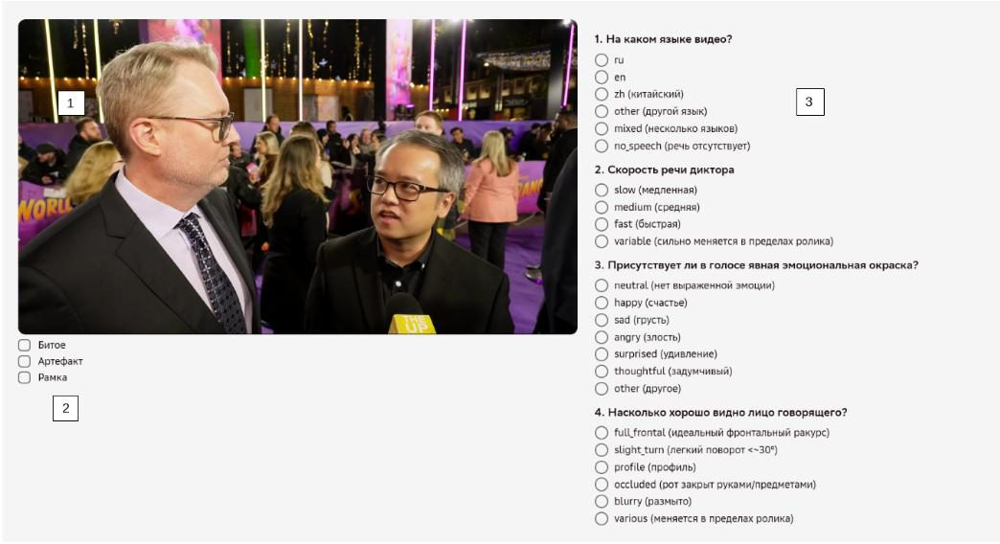

# Обзор проекта «Аватар. 3 этап (заявка 46)»

> ⚠️ **Это отдельный мануал**, не часть [мануала по 2 этапу](../manual-2-etap/00-overview.md)
> (заявки 26-28). У 3 этапа своя цель, свой классификатор (19 вопросов вместо 13) и частично
> другие критерии брака.

## Как 3 этап связан со 2 этапом

⚠️ **3 этап — это продолжение 2 этапа, не параллельный независимый проект**: на
3 этапе оцениваются **те же самые видео**, которые до этого искали и нарезали на сегменты на
2 этапе — то есть уже нарезанный фрагмент, который классификатор 3 этапа оценивает **целиком**
(см. [«Структура проекта»](#структура-проекта)), это и есть сегмент, вырезанный оператором
2 этапа.

При этом **допуск к этапам разный**: чтобы работать на 2 этапе, нужно сдать отдельный входной
экзамен 2 этапа (см.
[«Экзамен и допуск»](../manual-2-etap/00-overview.md#экзамен-и-допуск));
чтобы работать на 3 этапе — отдельный экзамен 3 этапа (проходной балл ≥80%, см.
[«Экзамен и допуск»](#экзамен-и-допуск)).

## Цель проекта

**Цель проекта:** научить модель лучше прорисовывать руки, естественную мимику, улучшить общее
качество видео.

**Задача:** просмотреть видео и оценить его на качество самой видеодорожки и аудио. Если видео
подходящего качества, нужно ответить на вопросы классификатора.

На видео могут быть речь, пение (в том числе вокализмы), а также молчание человека (если в этот
момент нет аудиодорожки с речью) при наличии движения рук.

`[Инструкция заказчика, 22.10.2026, стр.1]`

## Структура проекта

Работа (включая экзамен) выполняется на **платформе разметки**, в личном кабинете каждого
асессора; доступ к ней выдаёт **руководитель группы**.

На 3 этапе всего **одна заявка — №46**; задания выкладываются партиями внутри неё.

`[скриншот платформы Tagme, 03.09.2026]`

В отличие от 2 этапа, где асессор сам **ищет подходящий сегмент** (10–300 сек) внутри длинного
сырого видео, на 3 этапе единица задания — **уже нарезанный на 2 этапе фрагмент**, который
классификатор оценивает **целиком**: либо весь фрагмент годен, либо весь целиком уходит в
«битое», внутреннего поиска сегмента нет. Это тот же сегмент, что вырезал оператор 2 этапа —
см. [«Как 3 этап связан со 2 этапом»](#как-3-этап-связан-со-2-этапом).

> На 3 этапе каждое задание одновременно выполняют **три** разных асессора (тройное перекрытие) —
> в отличие от 2 этапа, где каждое задание выполняет только **один** асессор (однократное
> перекрытие). `[Переписка в Telegram с заказчиком, 04.03.2026]`

> Снятие асессора с одного из этапов **не затрагивает автоматически** его доступ ко второму.
> `[Переписка в Telegram с заказчиком, 30.03–02.07.2026]`

## Интерфейс разметки

1. Видео, которое нужно оценить.
2. Метки «Битое», «Артефакт» и «Рамка» — когда их ставить, см.
   [«Что не размечаем / Битое»](04-video-quality.md) и [«Что размечаем»](08-what-to-label.md).
3. Справа — классификатор, в котором нужно проставить метки к видео, см.
   [«Классификатор»](01-classifier.md).

`[Инструкция заказчика, 22.10.2026, стр.1]`

## Экзамен и допуск

≥80%

порог входного экзамена

10

заданий в каждой попытке

2

попытки

⚠️Прежде чем приступать к экзамену, обязательно изучите официальную инструкцию по проекту и
этот мануал целиком — правильные ответы на экзамене строятся именно на этих материалах.

Допуск к 3 этапу даёт **отдельный входной экзамен 3 этапа** с проходным баллом **≥80%**. Это не
тот же экзамен, что на 2 этапе: экзамены двух этапов сдаются раздельно и засчитываются каждый
только для своего этапа (см.
[«Как 3 этап связан со 2 этапом»](#как-3-этап-связан-со-2-этапом); про экзамен 2 этапа —
[«Экзамен и допуск»](../manual-2-etap/00-overview.md#экзамен-и-допуск)
в мануале 2 этапа).

В отличие от 2 этапа, экзамен 3 этапа **проверяется автоматически**. Порядок такой:

1. **Обучение** — 10 заданий.
2. **Первая попытка экзамена** — 10 заданий. Наберёте **≥80%** — доступ к рабочим заданиям
   заявки 46 откроется автоматически.
3. **Если порог не набран**, открывается **вторая попытка** — снова 10 заданий, и снова нужен
   порог **≥80%**.
4. **Третьей попытки не даётся** — при провале второй попытки результат финальный, «Экзамен не
   сдан».

`[Уточнение пользователя, 03.09.2026 и 04.11.2026; Почта. ОС Stage 3, апрель-июль 2026]`

## Как оценивается качество работы

95%

текущий норматив качества (по ханипотам)

250сек

норматив времени на задание

- **Норматив качества:** 95% по ханипотам («контрольным» заданиям с заранее известным правильным
  ответом). На 2 этапе такого автоматического показателя нет — там качество проверяет валидатор
  вручную, см. [мануал 2 этапа](../manual-2-etap/00-overview.md#как-оценивается-качество-работы).
- **Норматив времени на задание:** 250 секунд.

`[Почта. ОС Stage 3, апрель-июль 2026]`

## Обратная связь по выполненным заданиям

Обратную связь по выполненным заданиям может дополнительно давать заказчик или валидатор. Кроме
того, она выгружается в рабочую таблицу проекта для анализа ошибок. Эту обратную связь
обязательно нужно учитывать.
`[Уточнение пользователя, 04.11.2026]`

При этом обратную связь можно и нужно обсуждать: если ваша разметка кажется вам верной, а
комментарий заказчика или валидатора либо эталон в ханипоте вызывает сомнения — **не соглашайтесь
автоматически**, а аргументированно переспрашивайте и, если нужно, оспаривайте. Заказчик
рассматривает такие обращения и принимает по ним итоговое решение, вплоть до корректировки
эталона задним числом.

## Полезные материалы

- **Видео-обучение по 3 этапу:** <https://disk.yandex.ru/i/-Ifo0DfWfWt0EQ>

## Как читать этот мануал

- [06-general-requirements.md](06-general-requirements.md) — общие правила.
- [08-what-to-label.md](08-what-to-label.md) — что размечаем: подходящие видео, «Артефакт», «Рамка».
- [04-video-quality.md](04-video-quality.md) — что не размечаем: когда видео сразу «Битое».
- [01-classifier.md](01-classifier.md) — классификатор: 19 полей с правилами и примерами.
- [03-common-mistakes.md](03-common-mistakes.md) — частые ошибки.
- [07-example-library.md](07-example-library.md) — банк примеров для калибровки качества.

Источники — в [_sources-log.md](_sources-log.md).
