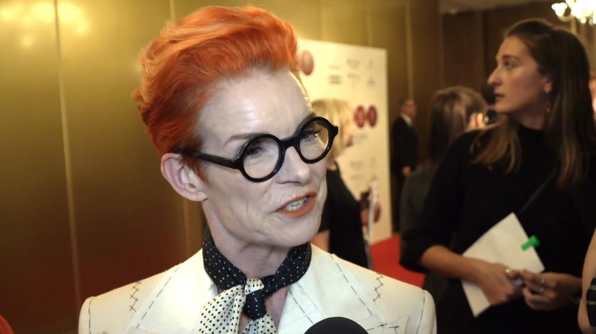
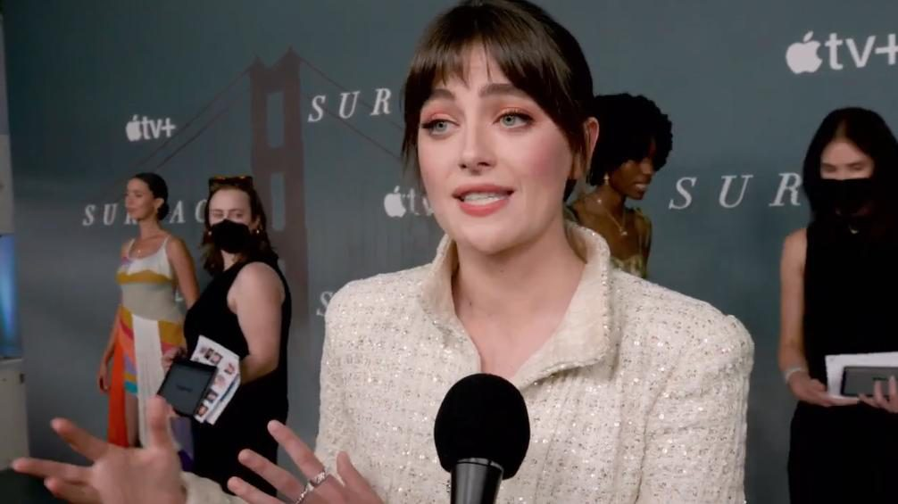
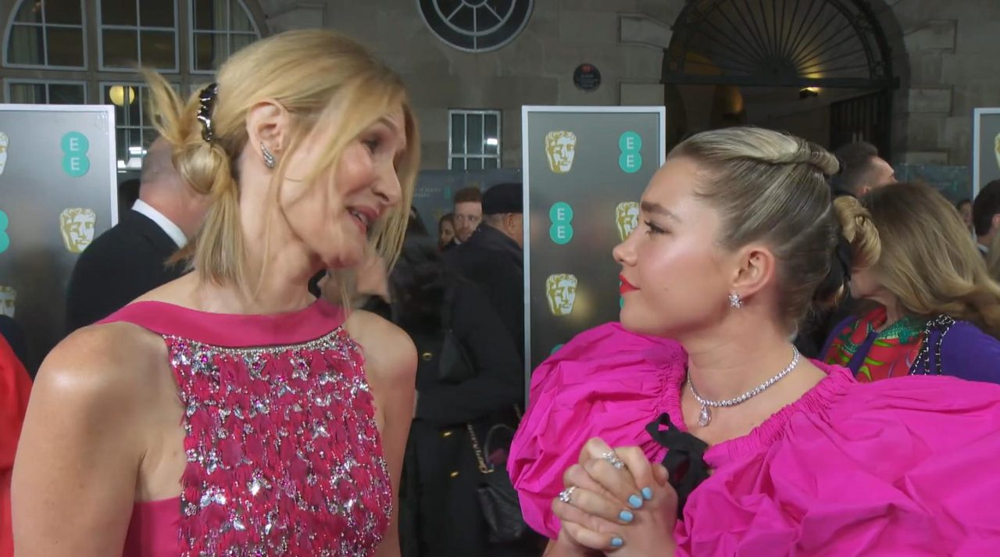
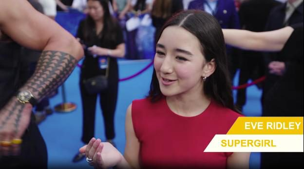
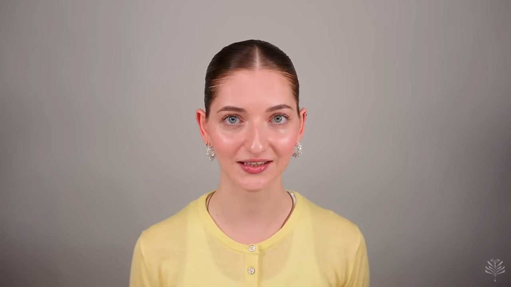
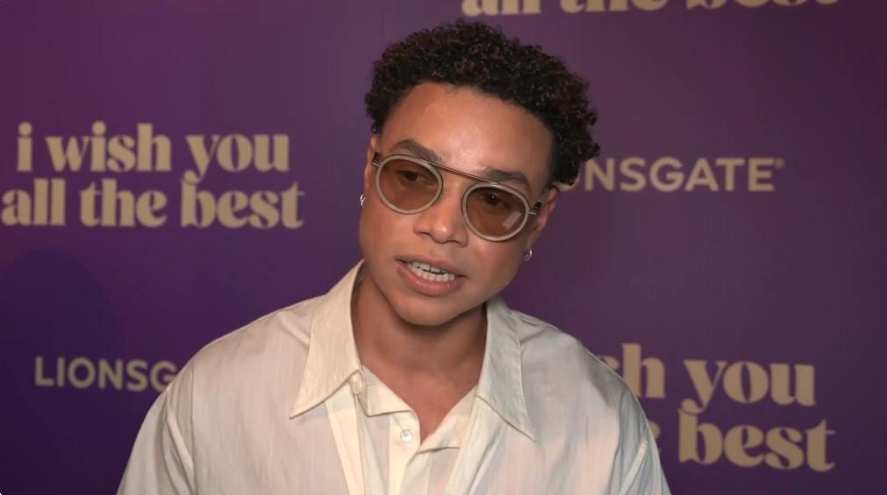
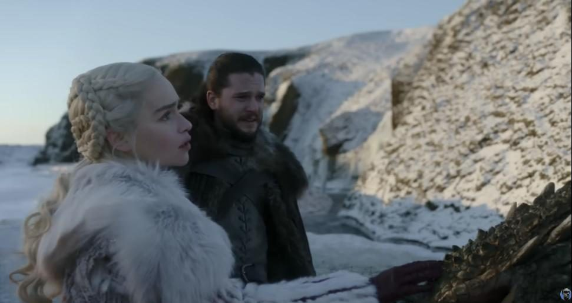
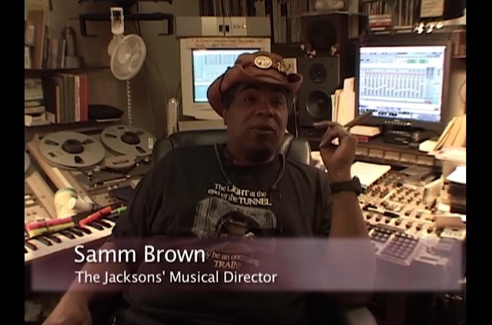

# Заполнение классификатора

## Общие правила

✅ Если видео не «Битое», заполнять классификатор **обязательно**: с незаполненным полем задание
не отправится.

✅ Вопросов **19**, в каждом можно выбрать **только один** вариант ответа.

⚠️ Если после заполнения классификатора нажать галку «Битое», все поля очистятся. Подходите к
классификации осознанно: неверные метки влияют на оценку качества вашей работы.

✅ Выбирается **один преобладающий критерий**. Если на видео несколько человек участвуют в
коммуникации, ориентируемся на того, кто **больше говорит**.

`[Инструкция заказчика, 22.10.2026, стр.2]`

В памятке к полям 1–9 указано, как выбирать ответ:

- **«Выбрать преобладающий критерий главного говорящего»** — ответ по тому, как ведёт себя
  главный говорящий (тот, кто в кадре говорит больше всего).
- **«Выбрать по факту»** — ответ по тому, что вы видели на видео, без привязки к главному
  говорящему: то, что случилось, даже если было минимальным.

`[Памятка Аватар 3 этап]`

Что сначала проверить до классификатора — когда видео сразу «Битое», когда ставится «Артефакт»
или «Рамка» — см. [«Что не размечаем / Битое»](04-video-quality.md) и
[«Что размечаем»](08-what-to-label.md).

## Поля классификатора

### 1. Язык видео

*Выбрать по факту.*

<ul class="value-checklist">
<li>ru</li>
<li>en</li>
<li>zh (китайский)</li>
<li>other (другой язык)</li>
<li>mixed (несколько языков)</li>
<li>no_speech (речь отсутствует)</li>
</ul>

`[Инструкция заказчика, 22.10.2026, стр.3]`

⚠️ Выбираем **преобладающий** язык. **mixed** ставим, если другого языка хотя бы **30%**.
`[Почта. ОС Stage 3, 13.04.2026]`

⚠️ Если на видео 2 человека говорят между собой на разных языках — **mixed**: в самом видео
присутствовало 2 языка. Если звучат названия, которые в оригинале на английском (или другом
языке), но их мало — вероятнее всего, язык один. `[Памятка Аватар 3 этап]`

⚠️ «Несколько языков» ставим, если на видео **значительное** использование нескольких языков.
Если вся речь на другом языке и только в конце фраза на русском — ставим только «другой язык».
`[Ответы на вопросы 3 этап, 12.10.2026]`

**Примеры:**

- [**mixed** — двое говорят между собой на разных языках](https://gigaeye-kandinsky-spark.obs.ru-moscow-1.hc.sbercloud.ru/ak/avatar/stage3_results/2b_lakhtionov_pool_017/-104523162_456239425__segment_1_0_15.mp4)
- [**один язык** — терминология на другом языке есть, но её мало](https://gigaeye-kandinsky-spark.obs.ru-moscow-1.hc.sbercloud.ru/ak/avatar/c9088ead-8c8b-4126-8d8e-da9965d1b0a8/trimmed/-50844118_456239348__segment_2_38_87__seg2.mp4)
- [**other**, а не mixed — вся речь на другом языке, в конце одна фраза по-русски](https://gigaeye-kandinsky-spark.obs.ru-moscow-1.hc.sbercloud.ru/kandi_de_team/post_train/stage2/video/avatars/c2ef48f4-95c8-4a89-b86f-97f93e02e41d/trimmed/5ObVLjvTToA__segment_31401148_59634004.mp4)
- [**en** (ошибочно ставили other)](https://gigaeye-kandinsky-spark.obs.ru-moscow-1.hc.sbercloud.ru/kandi_de_team/post_train/stage2/video/avatars/bced7e6b-a41b-4f58-a48f-4889054c689e/trimmed/P5UvOXm0dmI__segment_51473756_65483845.mp4)
- [**other** (ошибочно ставили en)](https://gigaeye-kandinsky-spark.obs.ru-moscow-1.hc.sbercloud.ru/kandi_de_team/post_train/stage2/video/avatars/3646c7f7-fc1f-4bc5-9e0f-3eaf3a8893a0/trimmed/YBoY_DyichA__segment_64834058_77203714.mp4)
- [**ru** (ошибочно ставили en)](https://gigaeye-kandinsky-spark.obs.ru-moscow-1.hc.sbercloud.ru/ak/avatar/695be3dc-c45e-44a4-bf5e-8e8f61179d41/trimmed/-157950684_456239085__segment_1_0_78.mp4)

`[ОС 3 этап на 05.11.2026]`

### 2. Скорость речи диктора

*Выбрать преобладающий критерий главного говорящего.*

<ul class="value-checklist">
<li>slow (медленная)</li>
<li>medium (средняя)</li>
<li>fast (быстрая)</li>
<li>variable (сильно меняется в пределах ролика)</li>
</ul>

Оценка субъективная, но если речь действительно быстрая, а вы поставите «slow (медленная)», это
будет ошибка. `[Инструкция заказчика, 22.10.2026, стр.3]`

⚠️ Если говорящий тянет слова и делает большие паузы между ними — **slow**.
`[Памятка Аватар 3 этап]`

⚠️ **Вокализмы** (пение без слов): скорость речи оцениваем по скорости звука, а в тоне и
соответствии (вопросы [3](#3-эмоциональная-окраска-голоса) и
[15](#15-соответствие-тона-голоса-выражению-лица)) ставим «нейтрально».
`[Почта. ОС Stage 3, 13.04.2026]`

**Примеры:**

- [**slow** — тянет слова](https://gigaeye-kandinsky-spark.obs.ru-moscow-1.hc.sbercloud.ru/ak/avatar/0c8de823-1003-4be0-9f16-b8ac600b0791/trimmed/-167333217_456239754__segment_1_1_173.mp4)
- [**medium** — быстрой речи нет](https://gigaeye-kandinsky-spark.obs.ru-moscow-1.hc.sbercloud.ru/ak/avatar/0c8de823-1003-4be0-9f16-b8ac600b0791/trimmed/-167333217_456239831__segment_2_36_57__seg2.mp4)
- [**fast** — очень тараторит, хотя есть небольшие паузы](https://gigaeye-kandinsky-spark.obs.ru-moscow-1.hc.sbercloud.ru/ak/avatar/1c35b7ef-b71d-48fc-94a7-b11274ce1cad/trimmed/-87150280_456239414__segment_1_28_51.mp4)
- [**medium** (ошибочно ставили fast)](https://gigaeye-kandinsky-spark.obs.ru-moscow-1.hc.sbercloud.ru/kandi_de_team/post_train/stage2/video/avatars/fa7935aa-c7fa-41ca-8b64-064732d3974f/trimmed/u2JP7tM7xBs__segment_2133497_40518901.mp4)
- [**medium** (ошибочно ставили fast)](https://gigaeye-kandinsky-spark.obs.ru-moscow-1.hc.sbercloud.ru/kandi_de_team/post_train/stage2/video/avatars/83c6bc0d-a995-49d8-93e7-374c23c2261c/trimmed/vdpQj0S4XF4__segment_28447566_4413734.mp4)
- [**вокализм** — скорость по скорости звука, в тоне и соответствии «нейтрально»](https://gigaeye-kandinsky-spark.obs.ru-moscow-1.hc.sbercloud.ru/ak/avatar/2d96202b-2347-4e9a-813c-d7ce2e6ccd70/trimmed/31802252_456239052__segment_2_73_87__seg2.mp4)

`[ОС Аватар примеры 3 этап (1) и (2); ОС 3 этап на 05.11.2026; Почта. ОС Stage 3, 13.04.2026]`

### 3. Эмоциональная окраска голоса

*Выбрать преобладающий критерий главного говорящего.*

<ul class="value-checklist">
<li>neutral (нет выраженной эмоции)</li>
<li>happy (счастье)</li>
<li>sad (грусть)</li>
<li>angry (злость)</li>
<li>surprised (удивление)</li>
<li>thoughtful (задумчивость)</li>
<li>other (другое)</li>
</ul>

Здесь нужно смотреть не только на лицо говорящего, но и прислушиваться к его интонации. Если есть
ощущение, будто человек зачитывает рапорт, — «neutral». Во всех остальных случаях выбираем
значение, соответствующее эмоции. Это поле напрямую связано с вопросом
[15](#15-соответствие-тона-голоса-выражению-лица): если здесь neutral, то и в вопросе 15 должно
быть neutral. `[Инструкция заказчика, 22.10.2026, стр.3]`

⚠️ Если проявление эмоций у человека не обнаружено, в вопросах 3 и 15 ставим **neutral**. Часто
лицо помогает определить эмоциональную окраску. `[ОС 3 этап на 05.11.2026]`

⚠️ В **other** относим то, что не подходит под перечисленное. Например, явный позитивный настрой
есть, но к счастью его не отнести — «другое». У человека сосредоточенное лицо — тоже «другое».
`[Вопросы 3 этап — ответы]`

⚠️ Не ставьте «other», если можно выделить счастье, злость или грусть: если человек радуется — это
happy, агрессивен — angry и т.д. Смотрим на преобладающий характер эмоции на видео: какое
настроение несёт повествование персонажа. `[Переписка в Telegram с заказчиком, 28.07.2026]`

⚠️ Счастье — это не только смех. Человек улыбается, доволен — **happy**.
`[Ответы на вопросы 3 этап, 12.10.2026]`

**Примеры:**

- [**happy**](https://gigaeye-kandinsky-spark.obs.ru-moscow-1.hc.sbercloud.ru/ak/avatar/1f4a641f-d256-41d3-b00a-8b246d8fec99/trimmed/-58787336_456239767__segment_3_79_90__seg3.mp4)
- [**happy**](https://gigaeye-kandinsky-spark.obs.ru-moscow-1.hc.sbercloud.ru/ak/avatar/1f58db0b-da16-4b3c-80fe-1d647ee5c666/trimmed/-69205063_456239229__segment_1_0_16__seg1.mp4)
- [**happy** — человек улыбается, доволен](https://gigaeye-kandinsky-spark.obs.ru-moscow-1.hc.sbercloud.ru/kandi_de_team/post_train/stage2/video/avatars/fa7935aa-c7fa-41ca-8b64-064732d3974f/trimmed/oVVTJwgjr7o__segment_3556866_15498402.mp4)
- [**neutral**](https://gigaeye-kandinsky-spark.obs.ru-moscow-1.hc.sbercloud.ru/ak/avatar/1f58db0b-da16-4b3c-80fe-1d647ee5c666/trimmed/-119060192_456239034__segment_1_40_53__seg3.mp4)
- [**neutral** — счастье не прослеживается](https://gigaeye-kandinsky-spark.obs.ru-moscow-1.hc.sbercloud.ru/ak/avatar/1f4a641f-d256-41d3-b00a-8b246d8fec99/trimmed/-144892536_456239685__segment_1_8_35.mp4)
- [**sad** — голос немного надрывается из-за надвигающихся слёз](https://gigaeye-kandinsky-spark.obs.ru-moscow-1.hc.sbercloud.ru/ak/avatar/695be3dc-c45e-44a4-bf5e-8e8f61179d41/trimmed/-110037720_456239047__segment_1_110_125.mp4)
- [**angry** (ошибочно ставили other)](https://gigaeye-kandinsky-spark.obs.ru-moscow-1.hc.sbercloud.ru/kandi_de_team/post_train/stage2/video/avatars/bced7e6b-a41b-4f58-a48f-4889054c689e/trimmed/3XewbOZLzcg__segment_41409652_54054778.mp4)
- [**other** — ирония](https://gigaeye-kandinsky-spark.obs.ru-moscow-1.hc.sbercloud.ru/ak/avatar/1f4a641f-d256-41d3-b00a-8b246d8fec99/trimmed/-187830095_456244648__segment_4_81_101__seg4.mp4)
- [**other** — сарказм](https://gigaeye-kandinsky-spark.obs.ru-moscow-1.hc.sbercloud.ru/ak/avatar/1f4a641f-d256-41d3-b00a-8b246d8fec99/trimmed/-68053471_456247352__segment_4_69_111__seg4.mp4)
- [**other** — выразительное чтение с долей мечтательности](https://gigaeye-kandinsky-spark.obs.ru-moscow-1.hc.sbercloud.ru/ak/avatar/1f4a641f-d256-41d3-b00a-8b246d8fec99/trimmed/-85266554_456240722__segment_1_0_20.mp4)
- [**other** — торжественность при чтении](https://gigaeye-kandinsky-spark.obs.ru-moscow-1.hc.sbercloud.ru/ak/avatar/0c8de823-1003-4be0-9f16-b8ac600b0791/trimmed/-167333217_456239754__segment_1_1_173.mp4)

`[Таблица с примерами по вопросам; ОС Аватар примеры 3 этап (1) и (2); ОС 3 этап на 05.11.2026;
Ответы на вопросы 3 этап, 12.10.2026]`

### 4. Насколько хорошо видно лицо говорящего

*Выбрать преобладающий критерий главного говорящего.*

<ul class="value-checklist">
<li>full_frontal (идеальный фронтальный ракурс)</li>
<li>slight_turn (лёгкий поворот &lt;~30°)</li>
<li>profile (профиль)</li>
<li>occluded (рот закрыт руками/предметами)</li>
<li>blurry (размыто)</li>
<li>various (меняется в пределах ролика)</li>
</ul>

`[Инструкция заказчика, 22.10.2026, стр.3]`

⚠️ Если не видно двух ушей (кроме идеального прямого взгляда в камеру и случая, когда уши закрыты
волосами) — **slight_turn**. Но оцениваем по большей части видео: если 80% времени человек смотрит
прямо, а 20% — с лёгким поворотом, ставим прямой взгляд. `[Памятка Аватар 3 этап]`

⚠️ Профиль встречается очень редко — выбираем **превалирующий** ракурс.
`[ОС Аватар примеры 3 этап (2)]`

⚠️ Если ракурсы сменяются и их доли **очень близки** (сложно определить преобладающий) — ставим
**various**. `[ОС 3 этап на 05.11.2026]`

⚠️ Если говорят двое, акцент на том, чьё лицо **в фокусе** во время речи.
`[ОС 3 этап на 05.11.2026]`

**Примеры:**

- [**full_frontal** — большая часть видео смотрит в камеру](https://gigaeye-kandinsky-spark.obs.ru-moscow-1.hc.sbercloud.ru/ak/avatar/37dde8dc-cb05-4319-8707-c11034e47e7c/trimmed/-65608907_456239303__segment_2_40_181__seg2.mp4)
- [**full_frontal** — большую часть видео ухо видно, преобладает фронтальный ракурс](https://gigaeye-kandinsky-spark.obs.ru-moscow-1.hc.sbercloud.ru/ak/avatar/695be3dc-c45e-44a4-bf5e-8e8f61179d41/trimmed/-110037720_456239047__segment_1_110_125.mp4)
- [**slight_turn** — не видно двух ушей](https://gigaeye-kandinsky-spark.obs.ru-moscow-1.hc.sbercloud.ru/ak/avatar/0c8de823-1003-4be0-9f16-b8ac600b0791/trimmed/-167333217_456239860__segment_1_32_49.mp4)
- [**slight_turn**, а не профиль — профиль встречается очень редко, выбираем превалирующий ракурс](https://gigaeye-kandinsky-spark.obs.ru-moscow-1.hc.sbercloud.ru/ak/avatar/1f4a641f-d256-41d3-b00a-8b246d8fec99/trimmed/-131143144_456240365__segment_2_30_233__seg2.mp4)
- [**slight_turn** — акцент на девушке: её лицо в фокусе во время речи, у молодого человека фокус пропадает](https://gigaeye-kandinsky-spark.obs.ru-moscow-1.hc.sbercloud.ru/kandi_de_team/post_train/stage2/video/avatars/9a1eb861-d0c1-4f90-8d2d-314fcc3f3877/trimmed/e6E0gmekmqM__segment_146818886_175500837.mp4)
- [**slight_turn** (ошибочно ставили full_frontal)](https://gigaeye-kandinsky-spark.obs.ru-moscow-1.hc.sbercloud.ru/kandi_de_team/post_train/stage2/video/avatars/bced7e6b-a41b-4f58-a48f-4889054c689e/trimmed/A3_hcFYHpm8__segment_0_19382093.mp4)
- [**profile** — почти не видно второго глаза](https://gigaeye-kandinsky-spark.obs.ru-moscow-1.hc.sbercloud.ru/ak/avatar/0c8de823-1003-4be0-9f16-b8ac600b0791/trimmed/-167333217_456239754__segment_1_1_173.mp4)
- [**profile** — преобладающий ракурс (около 85% времени)](https://gigaeye-kandinsky-spark.obs.ru-moscow-1.hc.sbercloud.ru/kandi_de_team/post_train/stage2/video/avatars/bced7e6b-a41b-4f58-a48f-4889054c689e/trimmed/cPPlAVrvhGY__segment_184105953_196530281.mp4)
- [**profile** у основного говорящего (мужчина); у женщины лёгкий поворот — виден второй глаз](https://gigaeye-kandinsky-spark.obs.ru-moscow-1.hc.sbercloud.ru/ak/avatar/7a9214c4-90ca-4d1c-a66a-80957e1fc431/trimmed/-95446622_456239101__segment_4_97_111__seg4.mp4)
- [**various** — фронтальный преобладает, но доли очень близки](https://gigaeye-kandinsky-spark.obs.ru-moscow-1.hc.sbercloud.ru/kandi_de_team/post_train/stage2/video/avatars/bced7e6b-a41b-4f58-a48f-4889054c689e/trimmed/AN6NJ6VqoGY__segment_115651067_126731277.mp4)
- [**various** — сложно определиться с преобладающим ракурсом](https://gigaeye-kandinsky-spark.obs.ru-moscow-1.hc.sbercloud.ru/kandi_de_team/post_train/stage2/video/avatars/bced7e6b-a41b-4f58-a48f-4889054c689e/trimmed/5nP9PQBmm5E__segment_9062696_27799565.mp4)

`[Таблица с примерами по вопросам; ОС Аватар примеры 3 этап (1) и (2); ОС 3 этап на 05.11.2026]`

### 5. Использует ли персонаж микрофон или телефон во время речи

*Выбрать по факту.*

<ul class="value-checklist">
<li>none (не использует)</li>
<li>microphone (говорит в микрофон)</li>
<li>phone (говорит по телефону/в телефон)</li>
</ul>

Петличный микрофон на одежде или головной микрофон возле рта — тоже использование, не только
когда человек держит микрофон в руке. `[Инструкция заказчика, 22.10.2026, стр.3]`

*Пример наличия микрофона: внизу расположен микрофон.* `[Инструкция заказчика, 22.10.2026, стр.4]`

⚠️ Если человек говорит в телефон и видно, что так идёт запись звука (телефон используется как
диктофон) — ставим **microphone**. `[Почта. ОС Stage 3, 01.04.2026]`

**Примеры:**

- [**microphone** — микрофон закреплён на рубашке; этот пункт часто отмечают неверно](https://gigaeye-kandinsky-spark.obs.ru-moscow-1.hc.sbercloud.ru/ak/avatar/0be25d06-671a-4512-b731-e5f5aaeef217/trimmed/-86457930_456239083__segment_1_72_91__seg1.mp4)
- [**microphone** — телефон используется как диктофон](https://gigaeye-kandinsky-spark.obs.ru-moscow-1.hc.sbercloud.ru/ak/avatar/be42f18f-8152-425d-9ada-0cdf65668287/trimmed/-12213578_456270557__segment_2_95_113__seg2.mp4)
- [**microphone** — микрофон присутствует](https://gigaeye-kandinsky-spark.obs.ru-moscow-1.hc.sbercloud.ru/kandi_de_team/post_train/stage2/video/avatars/bced7e6b-a41b-4f58-a48f-4889054c689e/trimmed/2z7VtdnvIJ8__segment_46736158_56985487.mp4)
- [**microphone** (ошибочно ставили none)](https://gigaeye-kandinsky-spark.obs.ru-moscow-1.hc.sbercloud.ru/kandi_de_team/post_train/stage2/video/avatars/bced7e6b-a41b-4f58-a48f-4889054c689e/trimmed/-sNl-O5ujCw__segment_0_13310675.mp4)
- [**none** (ошибочно ставили microphone)](https://gigaeye-kandinsky-spark.obs.ru-moscow-1.hc.sbercloud.ru/kandi_de_team/post_train/stage2/video/avatars/bced7e6b-a41b-4f58-a48f-4889054c689e/trimmed/FF_qOybK0Ao__segment_90414477_114148461.mp4)

`[ОС Аватар примеры 3 этап (1); Почта. ОС Stage 3, 01.04.2026; ОС 3 этап на 05.11.2026]`

### 6. Непрерывная ли сцена без монтажных склеек

*Выбрать по факту.*

<ul class="value-checklist">
<li>continuous (непрерывно)</li>
<li>contains_cut (есть монтажная склейка внутри)</li>
</ul>

`[Инструкция заказчика, 22.10.2026, стр.4]`

⚠️ Склейки в количестве **3 и более** — видео отправляется в «Битое», см.
[«Склейки»](04-video-quality.md#склейки). `[Инструкция заказчика, 22.10.2026, стр.2]`

**Примеры:**

- [**contains_cut** — на видео 2 склейки, а отмечено «непрерывно»](https://gigaeye-kandinsky-spark.obs.ru-moscow-1.hc.sbercloud.ru/ak/avatar/384a8f39-036c-423b-b136-6ef8128c9b96/trimmed/-6228806_456239207__segment_3_141_203__seg3.mp4)
- [**contains_cut** — есть склейка внутри, но выбрано «непрерывно»](https://gigaeye-kandinsky-spark.obs.ru-moscow-1.hc.sbercloud.ru/ak/avatar/1f4a641f-d256-41d3-b00a-8b246d8fec99/trimmed/-131143144_456240365__segment_2_30_233__seg2.mp4)
- [**contains_cut** — есть склейка внутри, но выбрано «непрерывно»](https://gigaeye-kandinsky-spark.obs.ru-moscow-1.hc.sbercloud.ru/ak/avatar/711cdcab-f4c6-4b8c-8035-9a82f9e5bb7b/trimmed/-51319627_456239043__segment_10_440_462__seg10.mp4)
- [**contains_cut** (ошибочно ставили continuous)](https://gigaeye-kandinsky-spark.obs.ru-moscow-1.hc.sbercloud.ru/kandi_de_team/post_train/stage2/video/avatars/bced7e6b-a41b-4f58-a48f-4889054c689e/trimmed/o39Kh27Y2Ic__segment_68399152_80061.mp4)

`[Инструкция заказчика, 22.10.2026, топ-5 ошибок; ОС 3 этап на 05.11.2026]`

### 7. Количество разных говорящих людей в аудиодорожке

*Выбрать по факту, отталкиваясь от уточнений.*

<ul class="value-checklist">
<li>1</li>
<li>2</li>
<li>3+</li>
</ul>

`[Инструкция заказчика, 22.10.2026, стр.4]`

⚠️ Здесь оцениваем **аудиодорожку, а не кадр**: считаем голоса, которые можно различить.
Неразборчивую речь на фоне в этом вопросе не оцениваем. `[Вопросы 3 этап — ответы]`

⚠️ Если слышна разборчивая речь закадрового голоса, который **взаимодействует** с человеком в
кадре, ставим то количество голосов, которое услышали. Если чёткая речь на фоне **не
взаимодействует** с человеком в кадре — «1», но в вопросе 8 тогда будет наложение речи.
`[Памятка Аватар 3 этап]`

**Примеры:**

- [**1** — разговоры на фоне в этом вопросе не оцениваем (наложение — в вопросе 8)](https://gigaeye-kandinsky-spark.obs.ru-moscow-1.hc.sbercloud.ru/ak/avatar/1c35b7ef-b71d-48fc-94a7-b11274ce1cad/trimmed/-87150280_456239414__segment_1_28_51.mp4)
- [**2** — на 22–23 сек короткий вопрос интервьюера](https://gigaeye-kandinsky-spark.obs.ru-moscow-1.hc.sbercloud.ru/kandi_de_team/post_train/stage2/video/avatars/bced7e6b-a41b-4f58-a48f-4889054c689e/trimmed/5nGlR4zlQ8A__segment_56721751_82179361.mp4)
- [**2** (ошибочно ставили 1)](https://gigaeye-kandinsky-spark.obs.ru-moscow-1.hc.sbercloud.ru/kandi_de_team/post_train/stage2/video/avatars/9a1eb861-d0c1-4f90-8d2d-314fcc3f3877/trimmed/B8C0m5oFjbM__segment_4383029_22336634.mp4)
- [**3+** — закадровый голос тоже есть](https://gigaeye-kandinsky-spark.obs.ru-moscow-1.hc.sbercloud.ru/kandi_de_team/post_train/stage2/video/avatars/0689c3ee-13b4-4d83-88bd-d5e264035809/trimmed/4uuG3Jl9vss__segment_145491355_160881233.mp4)
- [**3+** (ошибочно ставили 1)](https://gigaeye-kandinsky-spark.obs.ru-moscow-1.hc.sbercloud.ru/kandi_de_team/post_train/stage2/video/avatars/274de6ca-bd0e-4b8a-b302-e2a054c2c459/trimmed/YD_EJJgQ79M__segment_8561374_25814122.mp4)

`[ОС Аватар примеры 3 этап (2); ОС 3 этап 23.07; ОС 3 этап на 05.11.2026]`

### 8. Наложение речи (говорят ли несколько человек одновременно)

*Выбрать по факту, отталкиваясь от уточнений.*

<ul class="value-checklist">
<li>no_overlap (без наложения)</li>
<li>with_overlap (с наложением)</li>
</ul>

- **no_overlap** — на фоне есть речь, но она **неразборчивая** и является шумом помещения.
- **with_overlap** — помимо речи ключевого персонажа **хорошо слышна речь другого человека**,
  можно разобрать отдельные фразы.

`[Инструкция заказчика, 22.10.2026, стр.4]`

⚠️ Еле слышный разговор на фоне — **не** наложение. `[ОС 3 этап на 05.11.2026]`

**Примеры:**

- [**with_overlap** — дополнительные голоса на фоне здесь учитываем](https://gigaeye-kandinsky-spark.obs.ru-moscow-1.hc.sbercloud.ru/ak/avatar/1c35b7ef-b71d-48fc-94a7-b11274ce1cad/trimmed/-87150280_456239414__segment_1_28_51.mp4)
- [**with_overlap** — на 18-й секунде наложение речи](https://gigaeye-kandinsky-spark.obs.ru-moscow-1.hc.sbercloud.ru/ak/avatar/3ac0d9c6-6b88-4a08-92bc-9be5e9cd1879/trimmed/-52000967_456244256__segment_1_0_109.mp4)
- [**with_overlap** (ошибочно ставили no_overlap)](https://gigaeye-kandinsky-spark.obs.ru-moscow-1.hc.sbercloud.ru/kandi_de_team/post_train/stage2/video/avatars/274de6ca-bd0e-4b8a-b302-e2a054c2c459/trimmed/fvunp2Wo5iE__segment_48266581_66784893.mp4)
- [**no_overlap** — еле слышный разговор на фоне не является наложением](https://gigaeye-kandinsky-spark.obs.ru-moscow-1.hc.sbercloud.ru/kandi_de_team/post_train/stage2/video/avatars/bced7e6b-a41b-4f58-a48f-4889054c689e/trimmed/AqczXR7Fhyg__segment_10426431_30828555.mp4)
- [**no_overlap** (ошибочно ставили with_overlap)](https://gigaeye-kandinsky-spark.obs.ru-moscow-1.hc.sbercloud.ru/kandi_de_team/post_train/stage2/video/avatars/fa7935aa-c7fa-41ca-8b64-064732d3974f/trimmed/TK_u_2OmAQA__segment_0_24781.mp4)
- [**no_overlap** (ошибочно ставили with_overlap)](https://gigaeye-kandinsky-spark.obs.ru-moscow-1.hc.sbercloud.ru/kandi_de_team/post_train/stage2/video/avatars/fa7935aa-c7fa-41ca-8b64-064732d3974f/trimmed/uWkqYT2sRX4__segment_23814878_37624346.mp4)

`[ОС Аватар примеры 3 этап (2); Таблица с примерами по вопросам; ОС 3 этап на 05.11.2026;
Ответы на вопросы 3 этап, 12.10.2026]`

### 9. Сколько людей видно в кадре

*Выбрать по факту.*

<ul class="value-checklist">
<li>single (только 1 спикер)</li>
<li>multiple_static (другие присутствуют, но не взаимодействуют с основным спикером)</li>
<li>multiple_distracting (другие взаимодействуют, говорят, активно слушают, проявляют эмоции на речь говорящего)</li>
</ul>

При выборе ответа не обращаем внимание на людей на заднем плане: проходят мимо, стоят спиной,
размыты. Оцениваем основных персонажей. `[Инструкция заказчика, 22.10.2026, стр.5]`

⚠️ Если второй человек молчит, но **активно невербально проявляет интерес** к спикеру —
**multiple_distracting**. `[ОС Аватар примеры 3 этап (1)]`

**Скриншоты из инструкции:**

<!-- video-eyebrow: 9. Сколько людей видно в кадре — скриншоты -->

- 
- 

`[Инструкция заказчика, 22.10.2026, стр.5-6]`

**Примеры:**

- [**multiple_static** — другие не взаимодействуют с основным спикером (не смотрят на него, не кивают)](https://gigaeye-kandinsky-spark.obs.ru-moscow-1.hc.sbercloud.ru/ak/avatar/3ac0d9c6-6b88-4a08-92bc-9be5e9cd1879/trimmed/-52000967_456244256__segment_1_0_109.mp4)
- [**multiple_static** — другие не взаимодействуют, пустой взгляд в никуда](https://gigaeye-kandinsky-spark.obs.ru-moscow-1.hc.sbercloud.ru/ak/avatar/3ac0d9c6-6b88-4a08-92bc-9be5e9cd1879/trimmed/-147440564_456239071__segment_2_27_45__seg2.mp4)
- [**multiple_distracting** — в конце видео кивает ему](https://gigaeye-kandinsky-spark.obs.ru-moscow-1.hc.sbercloud.ru/ak/avatar/7a9214c4-90ca-4d1c-a66a-80957e1fc431/trimmed/-95446622_456239153__segment_2_61_73__seg2.mp4)
- [**multiple_distracting** (ошибочно ставили single)](https://gigaeye-kandinsky-spark.obs.ru-moscow-1.hc.sbercloud.ru/kandi_de_team/post_train/stage2/video/avatars/83c6bc0d-a995-49d8-93e7-374c23c2261c/trimmed/c5BLJ0fOCI4__segment_136980554_153229155.mp4)

`[Таблица с примерами по вопросам; ОС 3 этап на 05.11.2026]`

### 10. Субтитры, статичный текст, значки и лейблы

<ul class="value-checklist">
<li>none (нет)</li>
<li>background_text (фоновый текст: логотипы, значки, эмблемы, название программы)</li>
<li>subtitles (субтитры внизу)</li>
</ul>

Оцениваем **только наложенный** текст и значки — то, что появилось уже в процессе монтажа.
`[Инструкция заказчика, 22.10.2026, стр.6]`

⚠️ Если хоть на долю секунды появляется наложенный при монтаже материал (субтитры, вотермарка,
ФИО и т.п.), нужный тег ставится в любом случае. `[Памятка Аватар 3 этап]`

⚠️ Надпись с названием фильма на чёрном фоне, как правило, **физическая**: это подготовленные
комнаты для интервью, обычно на английском. Рекламный стенд при интервью со спортсменами — тоже
не монтажное наложение. `[Памятка Аватар 3 этап]`

⚠️ К субтитрам относятся и всплывающие окна с ФИО или должностью человека в кадре, а не только
субтитры, которые мы видим в кино. `[Памятка Аватар 3 этап]`

**Скриншоты из инструкции:**

<!-- video-eyebrow: 10. Субтитры, текст, значки — скриншоты -->

- 
- 
- 

`[Инструкция заказчика, 22.10.2026, стр.6-8]`

**Примеры:**

- [**наложенный текст есть** — пропуск текста грубая ошибка](https://gigaeye-kandinsky-spark.obs.ru-moscow-1.hc.sbercloud.ru/ak/avatar/0be25d06-671a-4512-b731-e5f5aaeef217/trimmed/-86457930_456239083__segment_1_72_91__seg1.mp4)
- [**subtitles** — показали ФИО](https://gigaeye-kandinsky-spark.obs.ru-moscow-1.hc.sbercloud.ru/ak/avatar/4301ce48-9f23-4e2d-b3c0-fc5ab4ddfe73/trimmed/-233912718_456239026__segment_1_3_17.mp4)
- [**subtitles** — на 22-й секунде](https://gigaeye-kandinsky-spark.obs.ru-moscow-1.hc.sbercloud.ru/ak/avatar/7bda4c3a-d21e-4320-98d3-d634e8413d54/trimmed/-95383488_171970745__segment_1_14_120.mp4)

`[ОС Аватар примеры 3 этап (1); Таблица с примерами по вопросам]`

### 11. Характеристика фона за спиной говорящего

<ul class="value-checklist">
<li>presentation_screen (презентация/экран с динамикой/движущаяся анимация/визуализация на фоне)</li>
<li>natural_static (естественный статичный: помещение, природа, город без движения)</li>
<li>natural_dynamic (естественный динамичный: люди, машины движутся, волны плещут)</li>
<li>solid_dark (однотонный тёмный)</li>
<li>solid_light (однотонный светлый)</li>
</ul>

`[Инструкция заказчика, 22.10.2026, стр.8]`

⚠️ Если на фоне виден косяк, угол стены и т.п. или в кадре стол/стул, на котором сидят, — это уже
**не однотонный** фон. `[Вопросы 3 этап — ответы]`

⚠️ Кирпичная стена, шумоизоляция треугольниками/квадратами — не однотонные. Склейка обоев и
любые перепады цветовых сегментов (с одной стороны серый, с другой светло-серый) — можно
разметить как однотон. `[Памятка Аватар 3 этап]`

⚠️ Лёгкие движения растений, мигание лампочек и прочая мелочь без активного движения —
**статичный** фон. `[Памятка Аватар 3 этап]`

⚠️ Если в отражении (например, в зеркале) есть движение — **динамичный** фон. Неподвижная тень —
статика, движущаяся — динамика. `[Почта. ОС Stage 3, 27.07.2026; ОС 3 этап на 05.11.2026]`

**Примеры:**

- [**solid_dark** — хоть и есть небольшие перепады цветов](https://gigaeye-kandinsky-spark.obs.ru-moscow-1.hc.sbercloud.ru/ak/avatar/1f58db0b-da16-4b3c-80fe-1d647ee5c666/trimmed/-214391033_456239025__segment_1_0_92.mp4)
- [**solid_light** — хоть и есть небольшие перепады](https://gigaeye-kandinsky-spark.obs.ru-moscow-1.hc.sbercloud.ru/ak/avatar/1f58db0b-da16-4b3c-80fe-1d647ee5c666/trimmed/-215695205_456239021__segment_1_17_37.mp4)
- [**однотон** — склейка обоев](https://gigaeye-kandinsky-spark.obs.ru-moscow-1.hc.sbercloud.ru/ak/avatar/c812c9a7-534c-4e5c-9b3d-61dddb237d76/trimmed/-194055153_456239189__segment_1_6_31.mp4)
- [**solid_light** (ошибочно ставили solid_dark)](https://gigaeye-kandinsky-spark.obs.ru-moscow-1.hc.sbercloud.ru/kandi_de_team/post_train/stage2/video/avatars/83c6bc0d-a995-49d8-93e7-374c23c2261c/trimmed/XDfp3EI_KMA__segment_0504411_4942403.mp4)
- [**natural_dynamic**](https://gigaeye-kandinsky-spark.obs.ru-moscow-1.hc.sbercloud.ru/ak/avatar/7bda4c3a-d21e-4320-98d3-d634e8413d54/trimmed/-158992716_456239018__segment_1_1_130.mp4)
- [**natural_dynamic** — отражение на фоне](https://gigaeye-kandinsky-spark.obs.ru-moscow-1.hc.sbercloud.ru/kandi_de_team/post_train/stage2/video/avatars/bced7e6b-a41b-4f58-a48f-4889054c689e/trimmed/5X67fnqARd4__segment_0207275_42699157.mp4)
- [**natural_dynamic** — на фоне собака](https://gigaeye-kandinsky-spark.obs.ru-moscow-1.hc.sbercloud.ru/kandi_de_team/post_train/stage2/video/avatars/bced7e6b-a41b-4f58-a48f-4889054c689e/trimmed/2z7VtdnvIJ8__segment_46736158_56985487.mp4)
- [**natural_static**](https://gigaeye-kandinsky-spark.obs.ru-moscow-1.hc.sbercloud.ru/ak/avatar/7bda4c3a-d21e-4320-98d3-d634e8413d54/trimmed/-160924535_456239620__segment_1_10_20.mp4)
- [**natural_static**](https://gigaeye-kandinsky-spark.obs.ru-moscow-1.hc.sbercloud.ru/ak/avatar/c26e2f37-a2f5-48a6-8f9f-c1b8dbbaa8f4/trimmed/-192873057_456239143__segment_1_41_51__seg1.mp4)
- [**natural_static**](https://gigaeye-kandinsky-spark.obs.ru-moscow-1.hc.sbercloud.ru/ak/avatar/fce8a423-3c2f-41a7-8593-73532ba90348/trimmed/-228773024_456239106__segment_2_110_144__seg2.mp4)
- [**natural_static**](https://gigaeye-kandinsky-spark.obs.ru-moscow-1.hc.sbercloud.ru/ak/avatar/fc9fad82-7a13-4aec-b36d-bf2998dceaae/trimmed/-74898402_456239975__segment_2_36_64__seg2.mp4)
- [**natural_static** (ошибочно ставили presentation_screen)](https://gigaeye-kandinsky-spark.obs.ru-moscow-1.hc.sbercloud.ru/kandi_de_team/post_train/stage2/video/avatars/9a1eb861-d0c1-4f90-8d2d-314fcc3f3877/trimmed/B8C0m5oFjbM__segment_4383029_22336634.mp4)

`[Таблица с примерами по вопросам; Памятка Аватар 3 этап; ОС 3 этап на 05.11.2026]`

### 12. Смена ракурса, зум, панорамирование во время речи

<ul class="value-checklist">
<li>static (камера закреплена)</li>
<li>moving (плавное движение)</li>
<li>shaky (тряска)</li>
</ul>

`[Инструкция заказчика, 22.10.2026, стр.9]`

⚠️ Если камера **дёрнулась хоть раз** — ставим **shaky**. `[ОС от заказчика, 18.08.2026]`

⚠️ Камера трясётся из-за «тремора рук», как будто по ней «ударили» или «топнули» рядом — то есть
есть резкие движения — **shaky**. Тряска может быть незаметной и лёгкой, но это всё равно тряска.
В остальных случаях — «плавная»: резких движений там нет. `[Памятка Аватар 3 этап]`

⚠️ Если камера не может стабилизироваться — **shaky**. Медленное движение камеры — **moving**.
`[ОС 3 этап на 05.11.2026]`

**Примеры:**

- [**shaky** — нет плавного движения камеры, тряска](https://gigaeye-kandinsky-spark.obs.ru-moscow-1.hc.sbercloud.ru/ak/avatar/7561daa6-313c-43c8-beca-1ca316707f1c/trimmed/-3118237_456239173__segment_1_0_15.mp4)
- [**shaky** — нет плавного движения камеры, тряска](https://gigaeye-kandinsky-spark.obs.ru-moscow-1.hc.sbercloud.ru/ak/avatar/20f7cee8-f47a-4104-8faa-cef6198042d9/trimmed/-31735024_456239258__segment_4_116_131__seg4.mp4)
- [**не static** — камера не закреплена](https://gigaeye-kandinsky-spark.obs.ru-moscow-1.hc.sbercloud.ru/ak/avatar/6f09b65c-0407-46fd-b245-bcd88e8605d5/trimmed/-5918002_456239422__segment_1_0_14__seg1.mp4)
- [**shaky**](https://gigaeye-kandinsky-spark.obs.ru-moscow-1.hc.sbercloud.ru/ak/avatar/0a7976df-4bc0-4333-a65a-a414f8b00e8b/trimmed/467342400_456239097__segment_1_21_68__seg1.mp4)
- [**shaky**](https://gigaeye-kandinsky-spark.obs.ru-moscow-1.hc.sbercloud.ru/ak/avatar/0a74208b-b92f-4236-855b-661eb57c1ddc/trimmed/-165317374_456239032__segment_6_174_213__seg5.mp4)
- [**shaky** — камера стабилизироваться не может](https://gigaeye-kandinsky-spark.obs.ru-moscow-1.hc.sbercloud.ru/kandi_de_team/post_train/stage2/video/avatars/bced7e6b-a41b-4f58-a48f-4889054c689e/trimmed/cmRYs4AIoJc__segment_0_19447211.mp4)
- [**shaky** — должна быть трясущаяся](https://gigaeye-kandinsky-spark.obs.ru-moscow-1.hc.sbercloud.ru/kandi_de_team/post_train/stage2/video/avatars/99cb79d8-7848-400e-bfa1-d3ee8ad3c1e8/trimmed/FHjVtVlLL9I__segment_29122103_306529365.mp4)
- [**moving** — медленное движение камеры](https://gigaeye-kandinsky-spark.obs.ru-moscow-1.hc.sbercloud.ru/kandi_de_team/post_train/stage2/video/avatars/c2ef48f4-95c8-4a89-b86f-97f93e02e41d/trimmed/aQimeAX5yL4__segment_14928491_61409548.mp4)
- [**moving** — плавная камера](https://gigaeye-kandinsky-spark.obs.ru-moscow-1.hc.sbercloud.ru/ak/avatar/3ac0d9c6-6b88-4a08-92bc-9be5e9cd1879/trimmed/-147440564_456239071__segment_2_27_45__seg2.mp4)
- [**moving** (ошибочно ставили static)](https://gigaeye-kandinsky-spark.obs.ru-moscow-1.hc.sbercloud.ru/kandi_de_team/post_train/stage2/video/avatars/c2ef48f4-95c8-4a89-b86f-97f93e02e41d/trimmed/Ly359IcdUFc__segment_0105672_56969837.mp4)
- [**static** (ошибочно ставили shaky)](https://gigaeye-kandinsky-spark.obs.ru-moscow-1.hc.sbercloud.ru/kandi_de_team/post_train/stage2/video/avatars/bced7e6b-a41b-4f58-a48f-4889054c689e/trimmed/CW_LsIKkUzE__segment_0_1823105.mp4)

`[Инструкция заказчика, 22.10.2026, топ-5 ошибок; Памятка Аватар 3 этап; Таблица с примерами по
вопросам; ОС 3 этап, 14.08.2026; ОС 3 этап на 05.11.2026]`

### 13. Насколько активно двигается персонаж в кадре

<ul class="value-checklist">
<li>low (плавные, спокойные движения, тело в основном статично)</li>
<li>medium (активная жестикуляция, повороты тела, головы)</li>
<li>high (перемещения персонажа по кадру, приближения к камере)</li>
</ul>

`[Инструкция заказчика, 22.10.2026, стр.9]`

⚠️ **low** — человек слегка качает головой и/или есть одно-два движения рук. Если есть
жестикуляция — уже **medium**. `[Памятка Аватар 3 этап]`

⚠️ При передвижении в кадре, а также при отдалении от камеры или приближении к ней ставим
**high**. `[Переписка в Telegram с заказчиком, 28.07.2026]`

**Примеры:**

- [**low** — лёгкие движения, нет резких](https://gigaeye-kandinsky-spark.obs.ru-moscow-1.hc.sbercloud.ru/ak/avatar/37dde8dc-cb05-4319-8707-c11034e47e7c/trimmed/-68719297_456239633__segment_2_50_62__seg2.mp4)
- [**low** (ошибочно ставили medium)](https://gigaeye-kandinsky-spark.obs.ru-moscow-1.hc.sbercloud.ru/kandi_de_team/post_train/stage2/video/avatars/c2ef48f4-95c8-4a89-b86f-97f93e02e41d/trimmed/CRJUXfz0jks__segment_54346891_90153327.mp4)
- [**medium** — подключена жестикуляция](https://gigaeye-kandinsky-spark.obs.ru-moscow-1.hc.sbercloud.ru/ak/avatar/0c8de823-1003-4be0-9f16-b8ac600b0791/trimmed/-167333217_456239860__segment_1_32_49.mp4)
- [**medium** — резко-активные движения головой](https://gigaeye-kandinsky-spark.obs.ru-moscow-1.hc.sbercloud.ru/ak/avatar/3ac0d9c6-6b88-4a08-92bc-9be5e9cd1879/trimmed/-167333217_456239923__segment_1_36_62.mp4)
- [**high** — пример высокой динамики из инструкции](assets/vysokaya-dinamika.mp4)
- [**high** — приближение к камере](https://gigaeye-kandinsky-spark.obs.ru-moscow-1.hc.sbercloud.ru/kandi_de_team/post_train/stage2/video/avatars/c2ef48f4-95c8-4a89-b86f-97f93e02e41d/trimmed/cwiRB2Bq4iE__segment_4689628_62534947.mp4)
- [**high** — незначительное приближение к камере](https://gigaeye-kandinsky-spark.obs.ru-moscow-1.hc.sbercloud.ru/kandi_de_team/post_train/stage2/video/avatars/bced7e6b-a41b-4f58-a48f-4889054c689e/trimmed/5nP9PQBmm5E__segment_9062696_27799565.mp4)
- [**high** — отдаление и приближение](https://gigaeye-kandinsky-spark.obs.ru-moscow-1.hc.sbercloud.ru/kandi_de_team/post_train/stage2/video/avatars/bced7e6b-a41b-4f58-a48f-4889054c689e/trimmed/9bsME5Bgn-U__segment_54388345_87783986.mp4)
- [**high** — перемещение по кадру](https://gigaeye-kandinsky-spark.obs.ru-moscow-1.hc.sbercloud.ru/kandi_de_team/post_train/stage2/video/avatars/9a1eb861-d0c1-4f90-8d2d-314fcc3f3877/trimmed/fStgv-515v0__segment_241356541_253158741.mp4)
- [**high** — человек перемещается по кадру слева направо и обратно](https://gigaeye-kandinsky-spark.obs.ru-moscow-1.hc.sbercloud.ru/kandi_de_team/post_train/stage2/video/avatars/a4a88aaf-71f7-4d51-9a3b-e785d4ec3ada/trimmed/sBtXCvh2-Z4__segment_1034436_49560187.mp4)

`[Инструкция заказчика, 22.10.2026, стр.9; Таблица с примерами по вопросам; ОС Аватар примеры 3
этап (1); ОС 3 этап, 14.08.2026; ОС 3 этап на 05.11.2026]`

### 14. Законченность фразы по смыслу

<ul class="value-checklist">
<li>complete (законченное предложение/мысль)</li>
<li>mid_sentence (обрыв на полуслове)</li>
<li>incoherent (набор слов, междометия, бессмыслица, нечленораздельность)</li>
</ul>

`[Инструкция заказчика, 22.10.2026, стр.9]`

⚠️ **complete** — только если слышим **логический** конец предложения. Если предложение
обрывается и конца мысли нет (например: «Ваня ехал на автомобиле в…») — **mid_sentence**; то же,
если оборвано слово. Иностранные языки, которых мы не понимаем, оцениваем на слух: если слово
оборвано — «обрыв на полуслове». `[Памятка Аватар 3 этап]`

⚠️ Если язык незнакомый (даже не английский), завершённость фразы определяем **по интонации**:
восходящая интонация — **mid_sentence**. `[Ответы на вопросы 3 этап, 12.10.2026]`

⚠️ Если в конце звучит «э-э» (междометие, заминка в речи) — **incoherent**.
`[ОС 3 этап на 05.11.2026]`

**Примеры:**

- [**complete** — в конце проговаривается слово «guys»](https://gigaeye-kandinsky-spark.obs.ru-moscow-1.hc.sbercloud.ru/kandi_de_team/post_train/stage2/video/avatars/bced7e6b-a41b-4f58-a48f-4889054c689e/trimmed/3GZfYV-_dIo__segment_293393_68087667.mp4)
- [**complete** (ошибочно ставили mid_sentence)](https://gigaeye-kandinsky-spark.obs.ru-moscow-1.hc.sbercloud.ru/kandi_de_team/post_train/stage2/video/avatars/bced7e6b-a41b-4f58-a48f-4889054c689e/trimmed/fnDdJtMwecU__segment_1600434_5511584.mp4)
- [**mid_sentence** — герой сказал «and then», неясно, что дальше он хотел сказать](https://gigaeye-kandinsky-spark.obs.ru-moscow-1.hc.sbercloud.ru/kandi_de_team/post_train/stage2/video/avatars/bced7e6b-a41b-4f58-a48f-4889054c689e/trimmed/7i0NrqKFOQc__segment_4210627_30498489.mp4)
- [**mid_sentence** — иностранный язык, интонация восходящая](https://gigaeye-kandinsky-spark.obs.ru-moscow-1.hc.sbercloud.ru/kandi_de_team/post_train/stage2/video/avatars/fa7935aa-c7fa-41ca-8b64-064732d3974f/trimmed/UasPUvgoxH8__segment_11932958_55537429.mp4)
- [**mid_sentence** — незавершённая мысль](https://gigaeye-kandinsky-spark.obs.ru-moscow-1.hc.sbercloud.ru/ak/avatar/1f4a641f-d256-41d3-b00a-8b246d8fec99/trimmed/-144892536_456239685__segment_1_8_35.mp4)
- [**incoherent** — в конце звучит «э-э»](https://gigaeye-kandinsky-spark.obs.ru-moscow-1.hc.sbercloud.ru/kandi_de_team/post_train/stage2/video/avatars/bced7e6b-a41b-4f58-a48f-4889054c689e/trimmed/cPPlAVrvhGY__segment_150503793_17026977.mp4)

`[ОС Аватар примеры 3 этап (2); ОС 3 этап на 05.11.2026; Ответы на вопросы 3 этап, 12.10.2026]`

### 15. Соответствие тона голоса выражению лица

<ul class="value-checklist">
<li>congruent (соответствует: сердитый голос — сердитое лицо)</li>
<li>incongruent (не соответствует: радостный голос — каменное лицо)</li>
<li>neutral (нейтрально)</li>
</ul>

**neutral** выбираем, если лицо человека особо не выражает эмоций и тон спокойный. Если в
[вопросе 3](#3-эмоциональная-окраска-голоса) стоит neutral, то и здесь должно быть neutral.
`[Инструкция заказчика, 22.10.2026, стр.3, 9]`

**Примеры:**

- [**neutral** — проявление эмоций не обнаружено, поэтому в вопросах 3 и 15 neutral](https://gigaeye-kandinsky-spark.obs.ru-moscow-1.hc.sbercloud.ru/kandi_de_team/post_train/stage2/video/avatars/bced7e6b-a41b-4f58-a48f-4889054c689e/trimmed/AqczXR7Fhyg__segment_10426431_30828555.mp4)
- [**neutral** — прописано в инструкции](https://gigaeye-kandinsky-spark.obs.ru-moscow-1.hc.sbercloud.ru/ak/avatar/0c8de823-1003-4be0-9f16-b8ac600b0791/trimmed/-167333217_456239860__segment_1_32_49.mp4)
- [**congruent** — человек рассуждает или вспоминает с акцентными нотами в голосе, тон эмоциям соответствует](https://gigaeye-kandinsky-spark.obs.ru-moscow-1.hc.sbercloud.ru/kandi_de_team/post_train/stage2/video/avatars/c2ef48f4-95c8-4a89-b86f-97f93e02e41d/trimmed/aQimeAX5yL4__segment_14928491_61409548.mp4)
- [**congruent** (ошибочно ставили neutral)](https://gigaeye-kandinsky-spark.obs.ru-moscow-1.hc.sbercloud.ru/ak/avatar/e9fb9859-062c-4e76-b3a7-9eeaf8ed092c/trimmed/-80991677_456240917__segment_1_3_37.mp4)

`[ОС Аватар примеры 3 этап (1); ОС 3 этап на 05.11.2026]`

### 16. Посторонние шумы, мешающие разобрать речь

<ul class="value-checklist">
<li>clean (чисто, только речь)</li>
<li>ambient_outdoor (уличный шум или природный)</li>
<li>ambient_indoor (шум помещения: кафе, офис)</li>
<li>music_bg (фоновая музыка)</li>
<li>noise_distortion (искажения микрофона)</li>
</ul>

`[Инструкция заказчика, 22.10.2026, стр.9]`

⚠️ Шум микрофона, который слышен всю запись как шипение (обычно на петличках), — **clean**.
`[Вопросы 3 этап — ответы]`

⚠️ Обращаем внимание на любой звук: чьи-то шаги, открытие/закрытие двери — уже **шум
помещения**; звук проезжающей машины — **шум улицы**. Звук, который отдаётся эхом, — **искажения
микрофона**. `[Памятка Аватар 3 этап]`

⚠️ Повторяющиеся звуки в помещении — **шум помещения**. Если какой-то стук встречается один раз —
**clean**. `[ОС 3 этап на 05.11.2026]`

⚠️ Если посторонних шумов очень мало, не обращаем на них внимания. Короткий посторонний звук в
самом конце видео, после завершения речи, — всё равно **clean**.
`[Почта. ОС Stage 3, 13.04.2026]`

Если фоновый шум, эхо или музыка **превалируют** и мешают воспринимать речь, видео отправляется в
«Битое», см. [«Звук»](04-video-quality.md#звук).

**Примеры:**

- [**clean** — с 49-й секунды небольшие посторонние звуки, недостаточно для шума помещения](https://gigaeye-kandinsky-spark.obs.ru-moscow-1.hc.sbercloud.ru/ak/avatar/384a8f39-036c-423b-b136-6ef8128c9b96/trimmed/-6228806_456239207__segment_3_141_203__seg3.mp4)
- [**clean** — посторонний звук после окончания речи](https://gigaeye-kandinsky-spark.obs.ru-moscow-1.hc.sbercloud.ru/ak/avatar/3c2ed997-8de8-4a19-a77a-4e5a8dab252e/trimmed/-209762835_456239099__segment_1_0_72.mp4)
- [**clean** — стук встречается один раз](https://gigaeye-kandinsky-spark.obs.ru-moscow-1.hc.sbercloud.ru/kandi_de_team/post_train/stage2/video/avatars/bced7e6b-a41b-4f58-a48f-4889054c689e/trimmed/caBOVW7ijHk__segment_4210092_23152695.mp4)
- [**clean** — монотонный звук микрофона, а не «искажения микрофона»](https://gigaeye-kandinsky-spark.obs.ru-moscow-1.hc.sbercloud.ru/kandi_de_team/post_train/stage2/video/avatars/d0b8ecc6-656b-45ca-8d56-443d2bccf531/trimmed/PSXUdI2mhTA__segment_93849046_117094436.mp4)
- [**clean** — нет постоянного шума, мешающего разобрать речь](https://gigaeye-kandinsky-spark.obs.ru-moscow-1.hc.sbercloud.ru/kandi_de_team/post_train/stage2/video/avatars/a4a88aaf-71f7-4d51-9a3b-e785d4ec3ada/trimmed/lOjRGKAWSzw__segment_60208815_105427248.mp4)
- [**ambient_indoor** — повторяющийся шелест бумаги](https://gigaeye-kandinsky-spark.obs.ru-moscow-1.hc.sbercloud.ru/kandi_de_team/post_train/stage2/video/avatars/bced7e6b-a41b-4f58-a48f-4889054c689e/trimmed/4XN4zt0Skd4__segment_0459036_236421.mp4)
- [**ambient_indoor** — повторяющиеся звуки в помещении](https://gigaeye-kandinsky-spark.obs.ru-moscow-1.hc.sbercloud.ru/kandi_de_team/post_train/stage2/video/avatars/bced7e6b-a41b-4f58-a48f-4889054c689e/trimmed/5X67fnqARd4__segment_0207275_42699157.mp4)
- [**ambient_indoor** — шум помещения (возможно, кондиционер)](https://gigaeye-kandinsky-spark.obs.ru-moscow-1.hc.sbercloud.ru/ak/avatar/stage3_results/2b_lakhtionov_pool_027/4128747_456239872__segment_1_9_45.mp4)
- [**ambient_outdoor** (ошибочно ставили ambient_indoor)](https://gigaeye-kandinsky-spark.obs.ru-moscow-1.hc.sbercloud.ru/kandi_de_team/post_train/stage2/video/avatars/bced7e6b-a41b-4f58-a48f-4889054c689e/trimmed/6gDACsPk-QE__segment_45483061_56851353.mp4)
- [**music_bg** — есть шум помещения и музыка, ставим музыкальный: его чётче слышно](https://gigaeye-kandinsky-spark.obs.ru-moscow-1.hc.sbercloud.ru/ak/avatar/7bda4c3a-d21e-4320-98d3-d634e8413d54/trimmed/-158992716_456239025__segment_1_16_44__seg1.mp4)
- [**noise_distortion** — эффект эха](https://gigaeye-kandinsky-spark.obs.ru-moscow-1.hc.sbercloud.ru/ak/avatar/87bae944-ca38-4b4c-9942-80b5690d138d/trimmed/-84487977_456243165__segment_1_0_299.mp4)

`[Почта. ОС Stage 3, 13.04.2026; ОС 3 этап, 14.08.2026; ОС 3 этап на 05.11.2026; Таблица с
примерами по вопросам; Памятка Аватар 3 этап]`

### 17. Вид съёмки

<ul class="value-checklist">
<li>professional_studio (профессиональная студийная съёмка: блогеры в студии, корпоративное видео)</li>
<li>professional_interview (профессионально снятое интервью: в студии или с хорошим светом/звуком)</li>
<li>street_interview (интервью на улице, часто ручная камера)</li>
<li>movie_scene (сцена из художественного фильма или сериала)</li>
<li>tv_entertainment (развлекательная телепередача, ток-шоу)</li>
<li>news_broadcast (новостной выпуск)</li>
<li>documentary (документальное кино)</li>
<li>lecture_presentation (лекция, презентация, образовательное видео)</li>
<li>amateur (любительская съёмка: домашнее видео, влог)</li>
<li>other (другое)</li>
</ul>

`[Инструкция заказчика, 22.10.2026, стр.9-10]`

⚠️ **Студия или интервью.** Если человек в студийной атмосфере (прямо студия, условно
записывается подкаст) **отвечает на вопрос** — это студийное интервью. Если просто рассказывает о
себе и т.п. — студийная съёмка. Если съёмка как будто профессиональная, но качество не очень
хорошее, — это уже любительское видео. `[Памятка Аватар 3 этап]`

⚠️ **Как заказчик понимает «проф. студию»:** съёмка на профессиональную камеру, с хорошим светом;
часто нейтральный фон, но может быть и специально созданная атмосфера с деталями. При загрузке на
платформу качество может сжиматься и появляться дефекты (отмечаем «артефактом»), но вид съёмки
остаётся «профессиональная студийная съёмка». Упрощённо: равномерный свет и однотон на фоне —
проф. студия; если берут интервью («ответы, рассказы») — проф. интервью. Допустима галочка
«Артефакт», но качество картинки — в пределах «мелких пикселей». `[Памятка Аватар 3 этап]`

⚠️ **Как заказчик понимает «любительскую» съёмку:** видео снято на непрофессиональную камеру,
часто в домашней обстановке, с невыставленным светом. Признаки: «телефонная» съёмка (тремор руки,
хаотичные движения), «домашнее», тусклое или непрямое освещение, нет лекции — больше впечатления
человека, размышления. Если видео снято в домашних условиях без хорошего света и прочей
атрибутики — любительская. `[Памятка Аватар 3 этап; Почта. ОС Stage 3, 13.04.2026]`

⚠️ **Лекция.** Критерий «лекция, презентация, образовательное видео» — наличие необходимых
составляющих: презентация, доска и прочие атрибуты. Видео не должно быть слишком коротким: иначе
это скорее рассуждения о чём-то, а не лекция. `[ОС 3 этап на 05.11.2026; Памятка Аватар 3 этап]`

⚠️ Видео с надписью в кадре может подходить под **news_broadcast**.
`[ОС Аватар примеры 3 этап (1)]`

**Скриншоты из инструкции:**

<!-- video-eyebrow: 17. Вид съёмки — скриншоты -->

- 
- 
- 

`[Инструкция заказчика, 22.10.2026, стр.10-12]`

**Примеры:**

- [**professional_studio** — хороший свет, однотон, студийное качество](https://gigaeye-kandinsky-spark.obs.ru-moscow-1.hc.sbercloud.ru/ak/avatar/34369717-c2c7-4230-a8e7-c3a679803c7d/trimmed/-211372791_456239023__segment_1_11_64.mp4)
- [**professional_studio**](https://gigaeye-kandinsky-spark.obs.ru-moscow-1.hc.sbercloud.ru/ak/avatar/09ac75d7-9bcf-4333-83e3-c984c0f4fedd/trimmed/-69784132_456239038__segment_1_4_32.mp4)
- [**professional_interview** — хороший свет есть](https://gigaeye-kandinsky-spark.obs.ru-moscow-1.hc.sbercloud.ru/ak/avatar/0c8de823-1003-4be0-9f16-b8ac600b0791/trimmed/-167333217_456239831__segment_2_36_57__seg2.mp4)
- [**professional_interview** — основной говорящий не перебивается, на фоне неразборчивая речь](https://gigaeye-kandinsky-spark.obs.ru-moscow-1.hc.sbercloud.ru/ak/avatar/09ac75d7-9bcf-4333-83e3-c984c0f4fedd/trimmed/-181548723_456239229__segment_1_5_23__seg1.mp4)
- [**professional_interview**](https://gigaeye-kandinsky-spark.obs.ru-moscow-1.hc.sbercloud.ru/ak/avatar/fb5f770b-a3be-402e-af20-a918ebbd699c/trimmed/-79147027_456240319__segment_1_0_34.mp4)
- [**street_interview**](https://gigaeye-kandinsky-spark.obs.ru-moscow-1.hc.sbercloud.ru/ak/avatar/7a9214c4-90ca-4d1c-a66a-80957e1fc431/trimmed/-55110198_456239033__segment_1_11_26__seg1.mp4)
- [**street_interview** (ошибочно ставили professional_interview)](https://gigaeye-kandinsky-spark.obs.ru-moscow-1.hc.sbercloud.ru/kandi_de_team/post_train/stage2/video/avatars/bced7e6b-a41b-4f58-a48f-4889054c689e/trimmed/5nGlR4zlQ8A__segment_118828142_130918412.mp4)
- [**news_broadcast** — из-за надписи](https://gigaeye-kandinsky-spark.obs.ru-moscow-1.hc.sbercloud.ru/ak/avatar/0be25d06-671a-4512-b731-e5f5aaeef217/trimmed/-86457930_456239083__segment_1_72_91__seg1.mp4)
- [**lecture_presentation**](https://gigaeye-kandinsky-spark.obs.ru-moscow-1.hc.sbercloud.ru/ak/avatar/0c8de823-1003-4be0-9f16-b8ac600b0791/trimmed/-167333217_456239860__segment_1_32_49.mp4)
- [**lecture_presentation** — видно, что идёт рассказ «кому-то»](https://gigaeye-kandinsky-spark.obs.ru-moscow-1.hc.sbercloud.ru/ak/avatar/03258c04-af9a-45a5-a804-bac962bae9bc/trimmed/-211587363_456239190__segment_1_2_22.mp4)
- [**lecture_presentation**, а не проф. съёмка — сзади плакат обучающего учреждения, звук с эхом](https://gigaeye-kandinsky-spark.obs.ru-moscow-1.hc.sbercloud.ru/ak/avatar/0a74208b-b92f-4236-855b-661eb57c1ddc/trimmed/-102895784_456239455__segment_2_62_128__seg2.mp4)
- [**образовательное видео**](https://gigaeye-kandinsky-spark.obs.ru-moscow-1.hc.sbercloud.ru/ak/avatar/1f4a641f-d256-41d3-b00a-8b246d8fec99/trimmed/-144892536_456239685__segment_1_8_35.mp4)
- [**amateur**, а не лекция — нет презентации, доски и прочих атрибутов](https://gigaeye-kandinsky-spark.obs.ru-moscow-1.hc.sbercloud.ru/kandi_de_team/post_train/stage2/video/avatars/bced7e6b-a41b-4f58-a48f-4889054c689e/trimmed/34ArIZkHvhY__segment_0385568_101508409.mp4)
- [**amateur** — резкие движения камеры: человек сам себя снимал](https://gigaeye-kandinsky-spark.obs.ru-moscow-1.hc.sbercloud.ru/kandi_de_team/post_train/stage2/video/avatars/9a1eb861-d0c1-4f90-8d2d-314fcc3f3877/trimmed/gEbAhPYr-SQ__segment_1362948_12398555.mp4)
- [**amateur** — качество съёмки камеры и складки ткани на фоне](https://gigaeye-kandinsky-spark.obs.ru-moscow-1.hc.sbercloud.ru/kandi_de_team/post_train/stage2/video/avatars/c2ef48f4-95c8-4a89-b86f-97f93e02e41d/trimmed/B6ljoqS9Mzg__segment_0725191_26003288.mp4)
- [**amateur** — нет проф. студийной съёмки](https://gigaeye-kandinsky-spark.obs.ru-moscow-1.hc.sbercloud.ru/ak/avatar/0c8de823-1003-4be0-9f16-b8ac600b0791/trimmed/-167333217_456239754__segment_1_1_173.mp4)
- [**amateur** — снято в домашних условиях без хорошего света и прочей атрибутики](https://gigaeye-kandinsky-spark.obs.ru-moscow-1.hc.sbercloud.ru/ak/avatar/fc9fad82-7a13-4aec-b36d-bf2998dceaae/trimmed/-86679510_456239195__segment_1_0_106__seg1.mp4)
- [**amateur** — «разностороннее» освещение, съёмка не на проф. оборудование](https://gigaeye-kandinsky-spark.obs.ru-moscow-1.hc.sbercloud.ru/ak/avatar/34369717-c2c7-4230-a8e7-c3a679803c7d/trimmed/-183227017_456240601__segment_1_23_153.mp4)
- [**не лекция** — видео слишком короткое, это рассуждения о чём-то](https://gigaeye-kandinsky-spark.obs.ru-moscow-1.hc.sbercloud.ru/ak/avatar/fa436163-9b31-4898-be44-f2824e99b84b/trimmed/-56649932_456239875__segment_4_141_152__seg4.mp4)

`[Таблица с примерами по вопросам; ОС Аватар примеры 3 этап (1) и (2); Почта. ОС Stage 3,
01.04.2026 и 13.04.2026; Вопросы 3 этап — ответы; ОС 3 этап на 05.11.2026; Памятка Аватар 3 этап]`

### 18. Объём и поза тела человека в кадре

<ul class="value-checklist">
<li>head_shoulders (голова и плечи)</li>
<li>up_to_the_waist (до пояса)</li>
<li>in_full_growth (в полный рост, с ногами)</li>
</ul>

`[Инструкция заказчика, 22.10.2026, стр.12]`

- **head_shoulders** — человека видно **по грудь** (по солнечное сплетение).
- **up_to_the_waist** — человека видно **по живот**.
- **in_full_growth** — видны **колени** (даже сидя, даже стоя).

`[Памятка Аватар 3 этап; ОС 3 этап на 05.11.2026]`

⚠️ Если объём тела чуть ниже груди, но до живота ещё не доходит, — **head_shoulders**. Лучше
ориентироваться на примерное положение пупка. `[ОС 3 этап на 05.11.2026]`

**Примеры:**

- [**head_shoulders** — не видно по живот](https://gigaeye-kandinsky-spark.obs.ru-moscow-1.hc.sbercloud.ru/kandi_de_team/post_train/stage2/video/avatars/bced7e6b-a41b-4f58-a48f-4889054c689e/trimmed/BusSUZ1F2us__segment_104170575_121399901.mp4)
- [**head_shoulders** — объём тела чуть ниже груди, до живота ещё не доходит](https://gigaeye-kandinsky-spark.obs.ru-moscow-1.hc.sbercloud.ru/kandi_de_team/post_train/stage2/video/avatars/9a1eb861-d0c1-4f90-8d2d-314fcc3f3877/trimmed/JqX0puS-oCU__segment_0750991_121335422.mp4)
- [**head_shoulders** (ошибочно ставили up_to_the_waist)](https://gigaeye-kandinsky-spark.obs.ru-moscow-1.hc.sbercloud.ru/kandi_de_team/post_train/stage2/video/avatars/9a1eb861-d0c1-4f90-8d2d-314fcc3f3877/trimmed/3UyS5Yve_yM__segment_122497073_154785525.mp4)
- [**up_to_the_waist** (ошибочно ставили head_shoulders)](https://gigaeye-kandinsky-spark.obs.ru-moscow-1.hc.sbercloud.ru/kandi_de_team/post_train/stage2/video/avatars/bced7e6b-a41b-4f58-a48f-4889054c689e/trimmed/PVU1Kt8T5Z0__segment_0050896_32980688.mp4)

`[ОС 3 этап на 05.11.2026]`

### 19. Пение или речь

<ul class="value-checklist">
<li>song (поёт)</li>
<li>speech (говорит)</li>
<li>song_and_speech (говорит и поёт)</li>
</ul>

`[Инструкция заказчика, 22.10.2026, стр.12]`

⚠️ Пение не обязательно должно содержать пропевание слов: вокализы допустимы.
`[Инструкция заказчика, 22.10.2026, стр.2]`

**Примеры:**

- [**song** (ошибочно ставили speech)](https://gigaeye-kandinsky-spark.obs.ru-moscow-1.hc.sbercloud.ru/kandi_de_team/post_train/stage2/video/avatars/9a1eb861-d0c1-4f90-8d2d-314fcc3f3877/trimmed/7oMU9njaZB4__segment_29405303_87571313.mp4)
- [**speech** (ошибочно ставили song)](https://gigaeye-kandinsky-spark.obs.ru-moscow-1.hc.sbercloud.ru/kandi_de_team/post_train/stage2/video/avatars/bced7e6b-a41b-4f58-a48f-4889054c689e/trimmed/q5xNnrYheYo__segment_0_34392322.mp4)

`[ОС 3 этап на 05.11.2026]`
