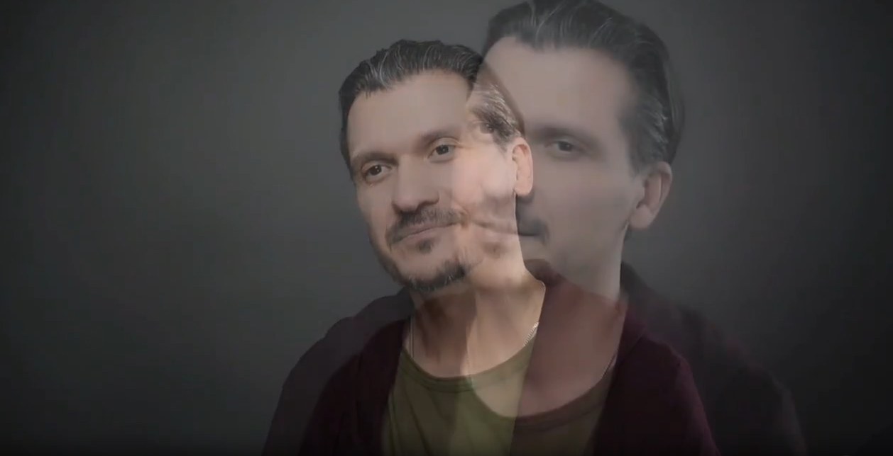

# Что не размечаем / Битое

Здесь собрано, из-за чего видео не подходит и отправляется в «Битое». Что размечаем, когда
ставится «Артефакт» и «Рамка», — см. [«Что размечаем»](08-what-to-label.md).

| Метка | Что делать |
|---|---|
| 🚫 **Битое** | На вопросы классификатора отвечать **не нужно** |
| 🎥 **Артефакт** | Отметить «Артефакт» и **ответить** на вопросы |
| ▭ **Рамка** | Отметить «Рамка» и **ответить** на вопросы |

`[Инструкция заказчика, 22.10.2026, стр.2; Памятка Аватар 3 этап]`

⚠️ Если после заполнения классификатора нажать галку «Битое», все поля очистятся.
`[Инструкция заказчика, 22.10.2026, стр.2]`

## 🚫 Когда видео сразу «Битое»

### Качество видео {: .field-label-heading }

Видео сильно пиксельное, зернит и размыто. `[Инструкция заказчика, 22.10.2026, стр.2]`

Сюда же относятся огромные квадратные пиксели и размазанное лицо. Размазаны глаза — человек в
кадре далеко, глаза как однотонное «месиво», нет возможности понять, куда смотрят зрачки. **Но
если глаза просто закрыты, видео подлежит разметке.** `[Памятка Аватар 3 этап]`

⚠️ **Граница «битое / артефакт».** Разбирая два битых видео и одно с артефактом, заказчик
объяснил разницу так. На битых: люди стоят далеко, есть полоса в районе рта, руки смазаны и местами
выглядят как пятна; пиксели заходят на пиксели — и на лице, и на руках; видео будто снято на старый
телефон. Видео с артефактом объективно лучше по качеству: человек ближе, есть пиксельное мерцание.
`[Вопросы 3 этап — ответы]`

**Примеры:**

- [Низкое качество, смазанность и пиксельность, особенно видна полоса в районе рта](assets/antiexample-1.mp4)
- [Тряска и низкое качество, лицо видно частично](assets/antiexample-4.mp4)
- [Низкое качество, похоже на формат видеозвонка](assets/antiexample-5.mp4)
- [Нет фокуса на человеке и руках, мутное видео](assets/antiexample-7.mp4)
- [Сильная пиксельность, тусклое освещение её усиливает, плохо распознаются черты лица](https://gigaeye-kandinsky-spark.obs.ru-moscow-1.hc.sbercloud.ru/ak/avatar/1c35b7ef-b71d-48fc-94a7-b11274ce1cad/trimmed/113690075_456239171__segment_1_0_129.mp4)
- [Очень большая смазанность, черты лица теряются: у человека справа словно стёрся глаз](https://gigaeye-kandinsky-spark.obs.ru-moscow-1.hc.sbercloud.ru/ak/avatar/1c35b7ef-b71d-48fc-94a7-b11274ce1cad/trimmed/-85053588_456239019__segment_2_79_90__seg2.mp4)

`[Инструкция заказчика, 22.10.2026, стр.13-14; ОС Аватар примеры 3 этап (2)]`

Большие наборы для калибровки «битое / артефакт / без артефакта» — в
[«Банке примеров»](07-example-library.md).

### Пожатие {: .field-label-heading }

При движении руки идут «лесенкой». `[Памятка Аватар 3 этап]`

**Пример:**

- [Плохое качество, при движении «пожатие», особенно в области рук](assets/antiexample-2.mp4)

`[Инструкция заказчика, 22.10.2026, стр.13]`

### Пережатие {: .field-label-heading }

Если поставить видео на скорость 0.5, в области головы видна «сыпучая» картинка. Так бывает,
когда хорошее видео сжимают в качестве и теряется оригинальная картинка. Как правило, такое
встречается на «качественных» кадрах. `[Памятка Аватар 3 этап]`

**Примеры:**

- [Видео с пережатым форматом, видны пиксели](assets/antiexample-6.mp4)
- [Пережатие](https://gigaeye-kandinsky-spark.obs.ru-moscow-1.hc.sbercloud.ru/ak/avatar/2d96202b-2347-4e9a-813c-d7ce2e6ccd70/trimmed/-920580_456239632__segment_1_0_15__seg1.mp4)
- [Пережатие](https://gigaeye-kandinsky-spark.obs.ru-moscow-1.hc.sbercloud.ru/ak/avatar/98b07575-daf2-4c46-afd7-4f2b98b7f3a8/trimmed/-229379287_456239017__segment_1_0_54.mp4)
- [Пережатие](https://gigaeye-kandinsky-spark.obs.ru-moscow-1.hc.sbercloud.ru/ak/avatar/stage3_results/2b_lakhtionov_pool_017/-30975723_456239030__segment_1_0_48.mp4)

`[Инструкция заказчика, 22.10.2026, стр.13; Памятка Аватар 3 этап]`

### Малое количество кадров (FPS) {: .field-label-heading }

«Прерывистая» картинка. Обращаем на это внимание, по сути, только на «профессиональных камерах».
`[Памятка Аватар 3 этап]`

**Примеры:**

- [Малое количество кадров](https://gigaeye-kandinsky-spark.obs.ru-moscow-1.hc.sbercloud.ru/ak/avatar/76a544e9-296a-4620-8ef9-cbd367cfe11a/trimmed/-14567_456241755__segment_1_8_33.mp4)
- [Малое количество кадров](https://gigaeye-kandinsky-spark.obs.ru-moscow-1.hc.sbercloud.ru/ak/avatar/76a544e9-296a-4620-8ef9-cbd367cfe11a/trimmed/-14567_456241796__segment_1_4_26.mp4)

`[Памятка Аватар 3 этап]`

### Наложение кадров {: .field-label-heading }

Плавный переход: постепенная смена двух кадров в виде наложения — относим в «Битое».
`[Инструкция заказчика, 22.10.2026, стр.14]` Простыми словами — видим одного человека, но он
дублируется при склейке или переходе. `[Памятка Аватар 3 этап]`

*Кадр из инструкции: наложение двух кадров при плавном переходе.*

**Примеры:**

- [Наложение полупрозрачного кадра](https://gigaeye-kandinsky-spark.obs.ru-moscow-1.hc.sbercloud.ru/ak/avatar/536eced6-c1ab-4ac2-8c6d-fd202ea20fa5/trimmed/-160788341_456239461__segment_6_203_214__seg6.mp4)
- [Наложение двух изображений в конце видео, хоть человека и видно](https://gigaeye-kandinsky-spark.obs.ru-moscow-1.hc.sbercloud.ru/ak/avatar/stage3_results/2b_lakhtionov_pool_019/-25605330_456240316__segment_1_48_61.mp4)

`[Таблица с примерами по вопросам]`

### Склейки {: .field-label-heading }

Склейки в количестве **3 и более** — «Битое». Меньшее количество допустимо (в
[вопросе 6](01-classifier.md#6-непрерывная-ли-сцена-без-монтажных-склеек) тогда ставим
contains_cut). `[Инструкция заказчика, 22.10.2026, стр.2]`

### Смена кадра без основного говорящего {: .field-label-heading }

В начале, середине или конце видео затемнение, текст, стена — человека вообще нет в кадре.
`[Памятка Аватар 3 этап]`

- Основной говорящий продолжает говорить, но после смены кадра его не видно — «Битое».
- После смены кадра виден **другой** человек, а основной говорящий продолжает речь — «Битое».
- Склейка с другим персонажем (или персонажами), которые ничего не говорят, а основной персонаж
  уходит из поля зрения, — «Битое», по аналогии с чёрным экраном и внезапными вставками.

`[Памятка Аватар 3 этап; Почта. ОС Stage 3, 30.04.2026]`

Когда появляется смена кадра с другим персонажем, видео автоматически становится битым.
`[ОС от заказчика, 21.10.2026]`

✅ На видео **один и тот же человек**, и видео хорошо смонтировано — такое можно взять.
`[Почта. ОС Stage 3, 13.04.2026]`

**Примеры:**

- [В самом начале участок чёрного цвета без персонажа (такие видео сразу бракуем), плюс сильно пикселит](https://gigaeye-kandinsky-spark.obs.ru-moscow-1.hc.sbercloud.ru/ak/avatar/1c35b7ef-b71d-48fc-94a7-b11274ce1cad/trimmed/219338794_456239316__segment_1_0_11.mp4)
- [Склейка с вопросом](https://gigaeye-kandinsky-spark.obs.ru-moscow-1.hc.sbercloud.ru/ak/avatar/536eced6-c1ab-4ac2-8c6d-fd202ea20fa5/trimmed/-4565_456239459__segment_1_14_85__seg1.mp4)
- [Основной говорящий говорит, смена кадра — его не видно](https://gigaeye-kandinsky-spark.obs.ru-moscow-1.hc.sbercloud.ru/ak/avatar/98b07575-daf2-4c46-afd7-4f2b98b7f3a8/trimmed/-167333217_456239628__segment_1_22_52__seg1.mp4)
- [Склейка с другим человеком, он молчит](https://gigaeye-kandinsky-spark.obs.ru-moscow-1.hc.sbercloud.ru/ak/avatar/stage3_results/2b_lakhtionov_pool_092/-216903061_456239609__segment_3_88_101__seg3.mp4)
- [Склейка с другим человеком, он молчит](https://gigaeye-kandinsky-spark.obs.ru-moscow-1.hc.sbercloud.ru/ak/avatar/stage3_results/2b_lakhtionov_pool_108/-210772886_456239075__segment_1_19_29.mp4)
- [Ключевой персонаж (мужчина) в самом конце сменяется другим — не подходит](https://gigaeye-kandinsky-spark.obs.ru-moscow-1.hc.sbercloud.ru/kandi_de_team/post_train/stage2/video/avatars/285ba119-8198-4781-b48e-aaac6d17d652/trimmed/OOLp7qDnfgo__segment_51353313_113252674.mp4)
- [✅ Один и тот же человек, хорошо смонтировано — можно взять](https://gigaeye-kandinsky-spark.obs.ru-moscow-1.hc.sbercloud.ru/ak/avatar/d65aba6a-55b2-4ae3-8bae-5a5a755dcd96/trimmed/-45280055_456240321__segment_1_6_214.mp4)

`[ОС Аватар примеры 3 этап (2); Памятка Аватар 3 этап; Почта. ОС Stage 3, 13.04.2026 и
30.04.2026; ОС от заказчика, 21.10.2026]`

### Виньетка {: .field-label-heading }

Затемняющие рамки по **углам** видео. Наличие виньетки — критерий для отправки в «Битое».
`[Памятка Аватар 3 этап; Почта. ОС Stage 3, 01.04.2026]`

**Пример:**

- [Виньетка](https://gigaeye-kandinsky-spark.obs.ru-moscow-1.hc.sbercloud.ru/ak/avatar/stage3_results/2b_lakhtionov_pool_028/-222562832_456239022__segment_1_27_106.mp4)

`[Почта. ОС Stage 3, 01.04.2026]`

### Звук {: .field-label-heading }

На видео с говорением есть **превалирующий** фоновый шум, эхо или музыка. Допускается лёгкий
аудиофон (например, тихая фоновая музыка, звуки среды), если он не мешает воспринимать речь и не
перекрывает её. `[Инструкция заказчика, 22.10.2026, стр.2]`

Допустимо любое (в том числе доминирующее) музыкальное сопровождение; пение не обязательно должно
содержать пропевание слов (вокализы допустимы). `[Инструкция заказчика, 22.10.2026, стр.2]`

- Если посторонние звуки мешают разобрать речь **даже частично** (например, очень слышен звук
  ветра) — «Битое». `[Почта. ОС Stage 3, 01.04.2026]`
- Видео с **ускорением или замедлением** — «Битое». `[Почта. ОС Stage 3, 01.04.2026]`
- Видео с **изменённой** речью — «Битое». `[Памятка Аватар 3 этап]`

**Примеры:**

- [Очень слышен звук ветра](https://gigaeye-kandinsky-spark.obs.ru-moscow-1.hc.sbercloud.ru/ak/avatar/75ed1897-eb70-4f5d-8222-a129f484476b/trimmed/-213127547_456291948__segment_4_75_98__seg4.mp4)
- [Ускорение / замедление](https://gigaeye-kandinsky-spark.obs.ru-moscow-1.hc.sbercloud.ru/ak/avatar/09ac75d7-9bcf-4333-83e3-c984c0f4fedd/trimmed/45905397_456239218__segment_2_108_125__seg2.mp4)
- [Изменённая речь (8-я секунда)](https://gigaeye-kandinsky-spark.obs.ru-moscow-1.hc.sbercloud.ru/ak/avatar/df0f56e0-a8e7-40bd-bc1e-99a17c0615e2/trimmed/-225116163_456239237__segment_1_35_81__seg1.mp4)

`[Почта. ОС Stage 3, 01.04.2026; Памятка Аватар 3 этап]`

### Технические помехи {: .field-label-heading }

Не должно быть технических помех, повреждённых участков аудио и видео.
`[Инструкция заказчика, 22.10.2026, стр.2]` Например, видео не грузится, обрывается, как-то
сломано. `[Памятка Аватар 3 этап]`

**Пример:**

- [На 2–3-й секунде звук «заикается»](https://gigaeye-kandinsky-spark.obs.ru-moscow-1.hc.sbercloud.ru/ak/avatar/536eced6-c1ab-4ac2-8c6d-fd202ea20fa5/trimmed/-34306859_456240138__segment_1_34_46__seg1.mp4)

`[Памятка Аватар 3 этап]`

### Синхронизация {: .field-label-heading }

Нет синхронизации аудио и видео (оценить визуально). Пропадает звук, а человек открывает рот, или,
наоборот, звук есть, а у говорящего не открывается рот. Допустимы короткий фрагмент закадровой речи
(например, во время интервью) и бэк-вокал во время пения. `[Инструкция заказчика, 22.10.2026,
стр.2]`

💡 Если сомневаетесь, попробуйте про себя проговорить речь из видео — станет понятно, успевают ли
ваши губы за губами говорящего. `[Памятка Аватар 3 этап]`

**Примеры:**

- [Отсутствие синхронизации, пение выглядит неестественно](assets/rassinhron.mp4)
- [Небольшое западание в синхронизации — «Битое»](https://gigaeye-kandinsky-spark.obs.ru-moscow-1.hc.sbercloud.ru/kandi_de_team/post_train/stage2/video/avatars/bced7e6b-a41b-4f58-a48f-4889054c689e/trimmed/7i0NrqKFOQc__segment_53441524_79225275.mp4)

`[Инструкция заказчика, 22.10.2026, стр.14; ОС 3 этап на 05.11.2026]`

### Закадровый голос {: .field-label-heading }

Если закадровый голос одномоментно (не на протяжении всего видео) говорит **больше 5 секунд** —
«Битое»; если меньше 5 секунд — размечаем. `[Памятка Аватар 3 этап]`

### Дубляж {: .field-label-heading }

Закадровый голос, который наложен на основного спикера и переводит его речь, — не берём.
`[Памятка Аватар 3 этап]` Разметить дубляж — очень грубая ошибка.
`[Почта. ОС Stage 3, 29.07.2026]`

### Перекрытие лица {: .field-label-heading }

Если сцена содержит большое количество кадров с перекрытием лица человека — относим в «Битое». `[Инструкция заказчика, 22.10.2026, стр.13]`

**Пример:**

- [Есть артефакты (блюр при движении, нестабильный свет), но много кадров с перекрытием лица — «Битое»](assets/antiexample-3.mp4)

`[Инструкция заказчика, 22.10.2026, стр.13]`

### Человек отвернулся {: .field-label-heading }

Человек слишком отвернулся, не видна артикуляция — видео не подходит.
`[ОС 3 этап, 14.08.2026]`

**Пример:**

- [Человек слишком отвернулся, артикуляции не видно](https://gigaeye-kandinsky-spark.obs.ru-moscow-1.hc.sbercloud.ru/kandi_de_team/post_train/stage2/video/avatars/d0b8ecc6-656b-45ca-8d56-443d2bccf531/trimmed/f7F-ZkD3qV0__segment_148877955_160529273.mp4)

`[ОС 3 этап, 14.08.2026]`
